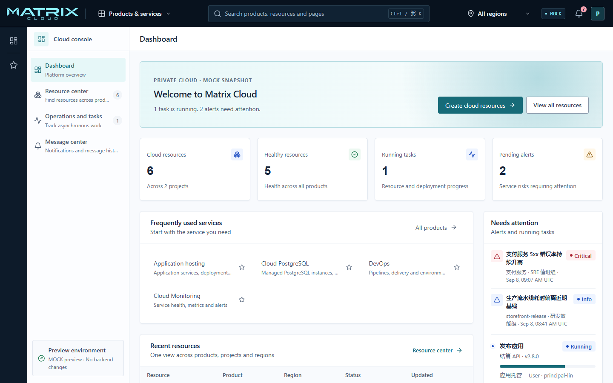
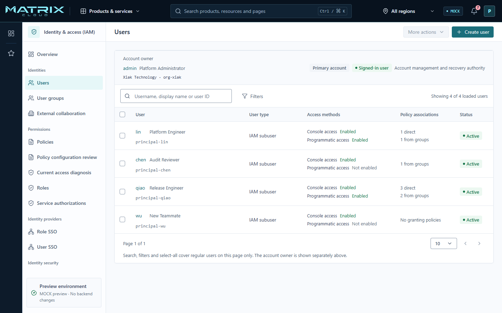
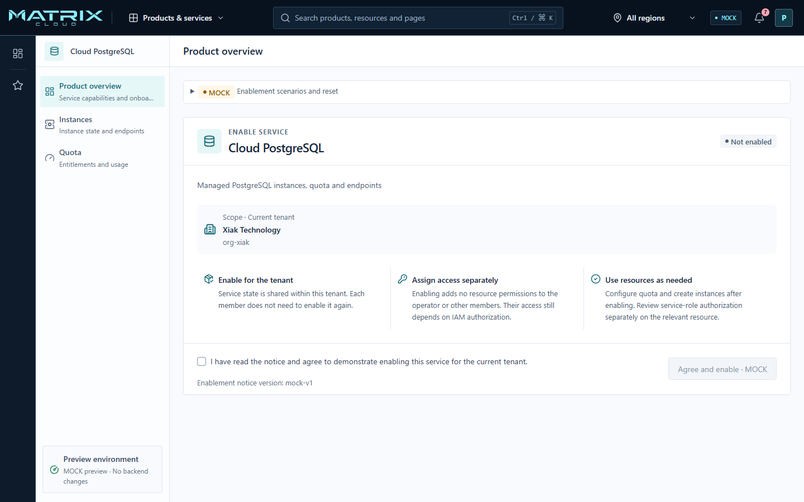

<picture>
  <source media="(prefers-color-scheme: dark)" srcset="app/ui/paas/_frontend/public/brand/matrix-horizontal-cyan.svg" />
  
</picture>

### Build your cloud. Keep control.

**Matrix is a self-hosted private-cloud control plane that brings
public-cloud-style identity, application delivery, managed services, and
operations to infrastructure you own.**

Your environment. Your authority. One cloud experience for the teams that
build, secure, and operate it.

[See Matrix in action](#see-matrix-in-action) ·
[Explore locally](#explore-locally) ·
[Install Matrix](docs/runbooks/platform-installation.md) ·
[Read the architecture](docs/architecture/README.md)

## Your infrastructure. A cloud experience.

Private infrastructure should not force every team to learn a different tool,
open an operator ticket, or bypass security to get work done. Matrix gives the
organization one account-aware front door for discovering products, delivering
applications, enabling cloud services, and following day-two operations.

| **Public-cloud experience** | **Governed self-service** | **Private by deployment** |
| --- | --- | --- |
| Give users one consistent console for products, resources, regions, tasks, and messages. | Let teams move quickly while identity, authorization, quotas, operations, and audit remain explicit. | Keep the control plane alongside the infrastructure, data, identities, and release lifecycle it governs. |

Matrix is not a thin dashboard over a collection of scripts. Its product
boundaries keep identity, application delivery, managed services, DevOps, and
infrastructure ownership separate while presenting them as one cloud
experience. [See the private-cloud product boundary](docs/architecture/ADR-0002-product-boundary.md).

## What Matrix helps teams do

- **Platform teams build one front door, not another portal.** Present
  independently owned products through a shared account, navigation, readiness,
  and operational model. [Explore the unified product shell](docs/features/FEAT-010-product-foundation-shell.md).
- **Security teams put authority inside the workflow.** Keep account ownership,
  users, groups, roles, policies, sessions, service identities, and audit
  evidence connected to the action they govern. [Explore IAM and Audit](docs/features/FEAT-006-platform-authorities.md).
- **Application teams work with product concepts instead of infrastructure
  internals.** Model applications, immutable revisions, deployments, placement,
  operations, and rollback without exposing Compose, SSH, or provider payloads
  as the public API. [Explore application hosting](docs/features/FEAT-001-apphosting-contracts.md).
- **Operators turn capabilities into governed cloud services.** Give each
  product an explicit enablement, quota, resource, endpoint, and service-role
  journey rather than an untracked manual handoff. [Explore managed-service activation](docs/features/FEAT-007-control-plane-console.md).
- **Infrastructure teams evolve what they already own.** Connect private-cloud
  regions and existing Linux capacity without making host credentials part of
  tenant authority. [Explore Linux host management](docs/features/FEAT-008-linux-host-management.md).

## See Matrix in action

**Discover → Enable → Authorize → Operate → Audit**

One journey connects the cloud account, product lifecycle, resource operation,
and evidence trail.

### Govern the account, not just a user list

The IAM workspace keeps the account owner visible and brings identity type,
access methods, policy sources, status, and bulk actions into one operational
view. Users can understand how access is obtained before changing it.

### Turn platform capabilities into cloud products

A service can be enabled once for the tenant without silently granting resource
permissions to the operator or every member. Access remains an IAM decision;
quota and resource operations remain product decisions.

## Built for private deployment

Matrix is designed for organizations that want a cloud operating model without
outsourcing the control plane. Product APIs stay provider-neutral, release and
authority boundaries stay explicit, and infrastructure adapters remain behind
the products that own their behavior.

- Start with a focused private-cloud platform and add independently accepted
  products without turning the runtime into a plugin marketplace.
- Preserve tenant and identity boundaries across products instead of trusting
  browser-selected context or infrastructure credentials.
- Operate through controlled installation, verification, upgrade, rollback,
  and recovery paths. [Follow the verified installation route](docs/runbooks/platform-installation.md).
- Verify repository, runtime, authority, installation, and browser behavior
  against the contracts they protect. [Explore repository delivery](docs/features/FEAT-009-repository-delivery.md).

## Explore locally

The console includes a browser-local **MOCK** experience for reviewing cloud,
PaaS, IAM, DevOps, observability, and managed-service journeys without writing
to a real IAM or infrastructure backend. It is the fastest way to understand
the interaction model before connecting a runtime.

Screenshots, routes, and MOCK journeys are product previews, not availability
claims. Matrix ships as independently accepted vertical slices; the linked
[feature contracts](docs/features/README.md) remain the source of truth for
scope, release gates, and evidence.

## Start here

- **Platform operators:** use the
  [installation runbook](docs/runbooks/platform-installation.md).
- **Product and platform engineers:** begin with the
  [feature contracts](docs/features/README.md) and the directly relevant
  [architecture decisions](docs/architecture/README.md).
- **API consumers:** use the versioned contracts for
  [IAM](api/iam/v1/README.md), [Audit](api/audit/v1/README.md),
  [PaaS](api/paas/v1/README.md),
  [managed services](api/managedservice/v1/README.md),
  [DevOps](api/devops/v1/README.md), and
  [installation](api/installation/v1/README.md).
- **Contributors and coding agents:** follow the repository
  [engineering instructions](AGENTS.md) and
  [dependency rules](docs/architecture/DEPENDENCY-RULES.md).
- **Donor inspection:** use the fixed-source
  [adoption records](docs/adoption/README.md); legacy repositories never become
  runtime or build dependencies.

## Repository map

- [`app/`](app/) — product applications and bounded-context implementations
- [`api/`](api/) — versioned external contracts
- [`deploy/`](deploy/) — deployment and installation assets
- [`test/`](test/) — cross-context acceptance and real-runtime gates
- [`.github/`](.github/) — repository automation and verification workflows
