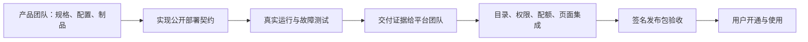

# 产品团队接入 Matrix：以 Logstash、Kibana 和 Redis 为例

这份手册给准备把自己的产品交给 Matrix 纳管的研发与交付团队使用。
目标是交付能够安装、验证、恢复和删除的产品实现，并给平台团队一份可复核的验收材料。
普通用户开通已经发布的产品，请看[托管服务使用手册](../user-guide/services-and-applications.md)。

本仓库提供 Logstash、Kibana 和 Redis 适配器及真实运行验收入口，使用与 PG、MySQL
相同的部署接口。先跑通这些例子，再交付自己的产品实现。
**控制台能否开通、哪些版本可以发布，以安装版本的目录和
[FEAT-007 的验收状态](../features/FEAT-007-control-plane-console.md#产品团队接入契约)为准。**
适配器测试通过后，还须由平台团队完成正式集成和发布验收。

## 1. 先分清双方交付什么

| 产品团队负责 | 平台团队负责 |
| --- | --- |
| 产品版本、规格、固定配置、依赖和凭据需求 | 校验当前租户、权限、配额及受信配置来源 |
| 安装、就绪判断、重复执行、失败恢复和精确删除 | 接收命令、记录任务、调度 worker、保存权威状态与审计 |
| 真实协议验证、数据保留与删除行为 | 控制台、目录发布、制品交付、平台升级和恢复组合 |
| 交付源码、制品身份、测试结果与维护联系人 | 复核证据，决定是否进入发布目录 |

要求和验收条件的唯一规范在 [FEAT-007 产品团队接入契约](../features/FEAT-007-control-plane-console.md#产品团队接入契约)。
下文带你按顺序完成交付，不另设一套验收标准。

## 2. 从可运行样例开始

先按[运行手册](../runbooks/managed-service-onboarding.md)准备本机 Docker、固定镜像和测试目录，
完成一次原样运行。这样可以先确认自己的环境具备验收条件，再调整产品实现。

| 示例 | 它实际证明什么 | 实现入口 |
| --- | --- | --- |
| Logstash | 带认证的 HTTP 输入被处理并写入持久文件；重启后数据保留 | [Logstash 适配器](../../app/adapter/managedservice/locallogstash/provisioner.go) |
| Kibana | 连接准确的同租户 Elasticsearch 依赖；通过真实接口创建、读取数据视图 | [Kibana 适配器](../../app/adapter/managedservice/localkibana/provisioner.go) |
| Redis | 带密码读写、TTL、持久化重启；双租户隔离与独立删除 | [Redis 适配器](../../app/adapter/managedservice/localredis/provisioner.go) |

Logstash 样例不依赖 Elasticsearch。Kibana 验收临时准备自己的 Elasticsearch，
用于证明依赖管理及删除边界；不要将它替换成生产数据库。
Redis 没有外部服务依赖，适合用来验证另一个产品家族也能复用相同契约。
各产品都验证平台部署契约，业务协议验证是其中一个环节。

Elastic 参考实现固定为 `8.19.23`，Redis 为 `8.2.11`，镜像摘要统一由
[制品清单](../../test/managedserviceonboarding/artifacts.json)维护。实际镜像在准备阶段加载，
产品安装阶段使用本地不可变镜像，不临时拉取或构建。
上游配置依据为 Elastic 的 [Logstash Docker 配置](https://www.elastic.co/guide/en/logstash/8.19/docker-config.html)
和 [Kibana 配置](https://www.elastic.co/guide/en/kibana/8.19/settings.html)；支持范围以 Matrix 自己的契约和实测为准。

## 3. 实现产品部署契约

产品团队直接引用 [公开适配契约](../../api/adapter/managedservice/v1/README.md)，
无需引用平台服务的 `internal` 包。示例的真实测试也只通过这个公开接口驱动实例。

| 你需要实现的方法 | 从用户结果看，什么才算完成 |
| --- | --- |
| `Ready` | 这个产品当前具备部署前提；检查本身不创建实例 |
| `Ensure` | 实例已经真正可用；重复调用或中途断线恢复不会多建一个实例 |
| `Delete` | 指定实例及约定的数据、凭据已经删除；重复调用仍能得到确定结果 |

输入中的租户、实例、版本、区域和规格由平台传入。输出只返回业务端点与凭据引用。
密码不会通过部署结果直接交给页面。产品的版本识别、健康检查、数据目录和实际协议
由产品团队负责；不能只用“容器正在运行”证明产品已经可用。

Docker 产品可以从 [Logstash 适配器](../../app/adapter/managedservice/locallogstash/provisioner.go) 开始：
提供封闭的规格与删除校验、固定配置和健康检查，再通过现有本地容器适配层组装。
目录创建、凭据保护、重复执行、状态观察、精确删除与恢复清单由共享实现处理，
产品团队无需重写一遍。产品自己的真实协议测试仍须保留。
同一适配器也由 Logstash 平台候选的 worker 调用，不需要维护两份生命周期。
正式交付状态以 [FEAT-007](../features/FEAT-007-control-plane-console.md#logstash-平台集成候选)为准。

## 4. 明确产品配置与依赖

开始编码前，双方应确认配置中哪些内容属于用户选择、哪些必须由平台解析。
各产品适配器拥有配置与不可变绑定；运行测试直接使用这些实现。
第一次安装后不能悄悄改写同一实例的配置。

**Logstash 示例**采用 `http-json-file-v1`：输入协议、输出位置和处理步骤固定。
平台生成输入认证材料，保护配置文件；测试发送一条数据，并验证处理结果落盘。
输入请求中的认证头不会写入示例输出数据。

**Redis 示例**采用 `authenticated-aof-v1`：每个实例生成自己的 `matrix` 业务账号密码，
关闭匿名访问，限制业务账号的管理能力。测试真正读写键值、验证过期时间，确认 AOF
落盘后重启，再检查原数据与密码仍可用。平台登录密码不能用来连接 Redis。
产品团队须说明内存上限、满额时的写入行为，以及持久化和业务备份的区别；当前边界见
[Redis 切片](../features/FEAT-007-control-plane-console.md#redis-接入切片)。

**Kibana 示例**采用 `elasticsearch-ui-v1`，按以下顺序处理依赖：

1. 平台核对所选 Elasticsearch 的账号、当前使用权限、READY 状态、观察版本和区域。
   接受后，把准确的依赖引用写入实例记录，再交给 worker；产品团队不能自行跳过这一步。
2. 适配器从受保护的实例记录核对准确依赖，通过固定运行时能力访问该容器，为当前 Kibana 发行自己的服务凭据。
   两个 Kibana 共用 Elasticsearch 时，各自的凭据和浏览器会话材料独立。
   平台本身运行在容器里时也要测试这一步：worker 内的回环地址不代表宿主机；
   可复用的固定协议操作由 [Compose runtime](../../app/adapter/apphosting/compose/runtime.go) 提供。
3. 保存对象和报表使用 Elasticsearch 所属的共享加密材料。删除 Kibana 会撤销它
   自己的服务凭据并清理自己的运行资源，保留 Elasticsearch 数据与共享密钥。
4. 创建或撤销凭据时断线，保留现场，用相同实例身份重试；不会把断线当作删除成功。
   已经运行的实例缺失凭据文件时会明确失败，不自动换密码掩盖问题。

对接页面或业务 API 时，用户只提交所选实例 ID 与读取到的 `resourceVersion`，
对应创建请求中的 `elasticsearch` 引用。列表刷新后观察版本改变，应重新选择；
结果未知时保留原请求，不自动改用最新依赖。权限管理员须为该准确 Elasticsearch
授权“使用实例”，具体 Action 和历史策略版本边界见
[依赖使用权限](../features/iam/FEAT-IAM-008-product-enforcement.md#详细设计)。

第一步的业务 API、当前权限、依赖绑定和删除保护属于平台集成验收；后续步骤由
[Kibana 依赖实现](../../app/adapter/managedservice/localkibana/dependency.go)与真实运行门禁证明。
各步是否已验收，请核对 [Kibana 切片](../features/FEAT-007-control-plane-console.md#kibana-依赖接入切片)。
**适配器的受信构造参数不是可以直接添加到租户请求中的 JSON 字段。**
产品团队不传入任意 URL、密码文件路径或 Docker 网络名。

Kibana 的后台服务凭据用于连接 Elasticsearch。打开 Kibana 后，用户仍使用
Elasticsearch 的业务账号登录；Matrix 登录态和后台服务凭据都不是 Kibana 用户密码。
依据见 Elastic 的[服务账号说明](https://www.elastic.co/guide/en/elasticsearch/reference/8.19/service-accounts.html)
和[共享保存对象加密材料](https://www.elastic.co/guide/en/kibana/8.19/xpack-security-secure-saved-objects.html)。

例如，准备支持更多 Pipeline 时，应先确定允许的配置结构、校验、版本与秘密引用，
再实现配置生命周期。不要把任意原生 DSL、URL、镜像或宿主机路径作为通用透传字段。

## 5. 跑测试，再查看验收结果

先与平台团队写清产品需要的网络关系：谁能连接产品、产品需要连接哪个已授权依赖、
是否允许出网、哪些租户之间必须互相不可达。不能仅交付 Docker 网络名或 K8s
命名空间，然后声称完成了租户隔离。对应 Provider 无法实现时，应明确拒绝交付该
隔离等级。

如果交付承诺网络隔离，应增加两个真实租户的正反向测试，覆盖私有地址、主机发布
入口、数据、凭据、重启和独立删除。当前可复用的验收路线及适用范围见
[MySQL 租户隔离](../features/FEAT-007-control-plane-console.md#docker-mysql-租户隔离)。
运行门禁分别验证 Logstash、Elasticsearch、Redis 的双作用域隔离，以及 Kibana 的私有网络
和准确依赖通路。不要因一个产品通过，就省略新产品在目标 Provider 上的验证。
这些适配器作用域测试仍须配合真实账号、权限和删除保护验收。

按运行手册依次执行[契约检查](../runbooks/managed-service-onboarding.md#契约检查)
和[真实运行验收](../runbooks/managed-service-onboarding.md#真实运行验收)。

契约检查会覆盖身份、规格和依赖错误，以及重复执行、配置漂移与秘密处理。
真实运行会启动产品，用真实协议验证，并经历重启、结果丢失恢复和删除。
测试结束会检查实例的数据、凭据及运行资源已经清理；Kibana 删除后还会验证依赖仍可用。

结果文件只有非秘密的版本、制品身份、时间、检查项和结论。
确认测试命令成功、结果为 `PASSED`，且 ELK 与 Redis 的预期检查项齐全。
默认的普通单元测试会跳过 Docker 运行；出现 `SKIP` 不能填写真实运行验收通过。
实际样例运行必须显式开启运行门禁，缺少镜像或环境会失败。

结果中的 `platformAndReleaseGates` 仍标记 `NOT_RUN`，表示该报告仅证明产品团队样例。
源码、接口或模拟测试成功，都不能替代后续真实用户权限和签名发布包验收。

Kibana 接入中断后，按结果选择恢复动作：

| 现象 | 产品团队应如何处理 |
| --- | --- |
| 创建或删除返回超时，结果未知 | 保留准确实例身份、依赖引用和保护文件，用原请求重试；先核对原生效果 |
| Elasticsearch 暂时不可用，Kibana 删除未完成 | 先恢复同一依赖，使凭据能够确认撤销，再重试删除；不要清空目录假装成功 |
| 正在运行的 Kibana 缺失凭据文件 | 从受保护托管材料中恢复准确凭据，交由维护者核查；不自动轮换共享身份 |
| Elasticsearch 已有保存对象，但共享密钥缺失 | 恢复对应密钥后再接入；不能生成新密钥冒充原密钥。平台备份不能替代产品数据和密钥备份 |

## 6. 把合格实现交给平台团队

交付时应附上以下材料，并让接收方能用同一源码与制品复跑：

- 源码提交、产品版本、镜像摘要及配置修订。
- 支持的规格、依赖要求、秘密交付方式。
- 契约检查结果、真实运行报告，以及未通过或未执行的检查。
- 数据放在哪里、重启保留什么、删除会删除什么。
- 超时或结果未知时如何恢复，谁负责定位产品内部故障。
- 维护负责人和下一步正式集成的责任人。

平台集成时逐项核对现有 owner：

| 集成点 | 代码或规范入口 |
| --- | --- |
| 产品定义、规格与开通/实例契约 | [managed-service API](../../api/managedservice/v1/README.md)、[目录](../../app/service/paas/internal/managedservice/domain/catalog.go)；数据库规格与版本约束从目录生成，无需另写产品名单 |
| 配置解析、依赖授权与持久化 | [managedservice 业务实现](../../app/service/paas/internal/managedservice)、[权限接入要求](../features/iam/FEAT-IAM-008-product-enforcement.md) |
| 目录与运行实现一一对应 | [worker 组装](../../app/service/paas/cmd/matrix-paas-worker/main.go)、[注册校验](../../app/service/paas/internal/managedservice/usecase/reconcileinstallation/providers.go) |
| 产品入口与真实页面 | [产品描述](../../app/ui/paas/_frontend/src/features/control-plane/domain/managedServiceProduct.ts)统一登记路由、发现入口、导航、图标与连接提示；配套中英文说明由同一前端维护 |
| 固定制品、安装与恢复 | [发布组装](../../deploy/releasebuild)、[生命周期 owner](../features/FEAT-005-offline-platform-lifecycle.md) |

只新增目录项会被运行实现校验拒绝。只放入镜像或增加页面，也不能完成接入。
需要新增字段时，应一并更新生成的契约、校验、幂等摘要、存储与恢复测试。

## 7. 完成平台验收后再发布

双方按 FEAT-007 中的 **P1 平台集成**、**P2 发布验收**提交证据。
产品团队继续支持真实协议和故障复现，平台团队验证真实 IAM、配额、任务恢复、审计、
浏览器使用以及签名包生命周期。全部必要检查通过后，产品才能进入正式目录。

以下状态应分别记录：**样例已验证 → 集成待验收 → 发布已验收**。
交接时核对当前源码、当前报告和私有候选与正式发布的边界，
不能只读取适配器报告中的 `PASSED`。
Redis 沿用同一条接入路径，不需要新增 IAM 求值、配额或任务工作流。
是否已完成平台与发布验收仍以 owning FEAT 为准，不能从目录存在推导已发布。
HA、产品引擎升级、业务数据备份和任意 Pipeline 编辑需要各自的明确接入范围。
