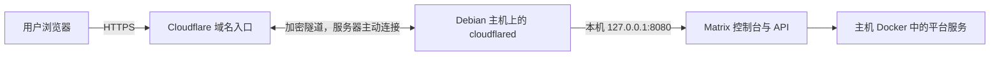

# 安装与维护 Matrix

这份指南供负责平台的运维人员使用。普通成员从[首次登录](../user-guide/getting-started.md)开始。
下面沿用已执行过的安装与维护命令；适用版本和验收范围由
[平台交付功能记录](../features/FEAT-005-offline-platform-lifecycle.md)维护。
主线代码不等于已经通过完整交付验证的安装包。

开始前先核对[当前主线的本地安装结果](../features/FEAT-005-offline-platform-lifecycle.md#当前主线本机-docker-安装复核)。
安装、首次使用与维护均须以对应交付版本的实际结果为准。
不能把历史版本的验证结果当作新包的完整生命周期保证。

## 安装前准备

### 领取与核验安装包

打开 [Matrix 发布页](https://github.com/xiak/matrix/releases)，选择与部署入口匹配的版本，
下载 Assets 中的全部安装附件到同一目录。安装包分为两个 `.part-*` 文件，
需要同时领取校验文件、发布清单、签名、信任文件及 `acceptance-evidence.zip`。
GitHub 自动提供的 **Source code** 是源码，不能用作安装包。

在 Linux 主机上按发布页的校验、重组与解压步骤还原 `matrix-release` 目录。
每一步都成功后再继续；缺少分片或校验不符时重新领取正确附件，不跳过检查。
信任文件的公开指纹由可信交付人员核对，不能只凭同一下载目录里的校验值建立信任。
验收压缩包供查看报告和截图，不作为安装输入。

解压目录本身就是完整发布包，其中 `bin/mx` 是配套安装工具。
可以直接使用它的绝对路径：把下文 `/usr/local/sbin/mx` 换成该文件的实际位置，
把 `/srv/matrix-release` 换成解压目录的实际位置。不要把分片、源码归档或包含
所有下载附件的父目录当作 `--bundle`。信任文件与安全邮件配置仍须按下表单独保护。

本包用于全新安装；已有平台先核对支持的维护路径。正式交付的准确身份和验收结果见
[平台交付功能记录](../features/FEAT-005-offline-platform-lifecycle.md#当前主线本机-docker-安装复核)。

### 准备安装材料

先向交付负责人领取配套材料，确认版本、主机和访问地址后再开始：

| 需要准备 | 本文示例位置或要求 |
| --- | --- |
| 安装主机 | 独立的 Linux/amd64 主机或虚拟机，已安装 Docker Engine 与 Compose 插件 |
| 安装工具 | 已验证发布目录中的 `bin/mx`；下文示例约定为 `/usr/local/sbin/mx` |
| 完整离线发布包 | `/srv/matrix-release`，与安装工具配套 |
| 发布信任文件 | `/etc/matrix/release-trust.json`，由可信交付渠道提供 |
| 安全邮件配置 | `/etc/matrix/security-mail.json`，由交付人员准备并保护，供安全通知与验证码使用 |
| 安装目录 | `/var/lib/matrix`，首次安装必须为空，由 root 独占访问 |
| 网络与支持渠道 | 事先确认受限访问方式、控制台完整地址和负责故障处理的人员 |

示例路径可以按交付约定替换，后续维护始终使用同一安装目录。
发布包、信任文件和邮件配置放在安装目录之外。
诊断文件则必须输出到本安装的 `support/` 子目录，见[导出支持信息](#导出支持信息)。
仓库中的源码、演示页面或某个单独镜像不能代替完整发布包。

领取材料时请交付人员同时给出发布标识、校验方式、邮件服务的连通性确认和支持联系人。
邮件配置需要真实可用的服务器、认证信息及 TLS 信任材料；不能拿空文件或示例密码代替。
没有配套发布包时，先由发布人员完成构建与交付，不要求普通用户从源码拼装安装材料。
通过 Windows 中转文件时，须保留目录结构，并按已验证的发布清单恢复所有文件的执行位：
工具程序需要可执行，镜像归档等非执行文件则不能带执行位；仅给 `mx` 加执行权限还不够。

**不需要另起 DinD 容器才能安装。** 当前部署使用主机上的 Docker Engine，
通过本机 `/var/run/docker.sock` 管理工作负载。远程 Docker、Rootless Docker、
Kubernetes 和多节点控制平面不属于本页的安装流程。

**先选定访问入口，再选择配套版本。** 已发布的 v0.3.0 只接受 HTTP 和显式端口 `8080`；
示例地址为 `http://127.0.0.1:8080`。安装参数里的地址用于请求校验，
不是该版本的监听绑定；服务仍监听 `0.0.0.0:8080`。
安装器不会替你配置防火墙，不能因此假定只有本机能够访问。
请由部署人员事先提供网络隔离与访问方式；不能把这个包直接用于公网 HTTPS 部署。
腾讯云与 Cloudflare Tunnel 使用[下方的 HTTPS 部署流程](#腾讯云-debian-与-cloudflare-tunnel)，
须领取包含该功能且完成验收的新包，不能只把旧安装命令的 `http` 改为 `https`。
安装前还会检查节点接入端口 `8443` 是否空闲；仅确认 `8080` 空闲还不够。

主机资源是否足够，以交付包声明的要求与安装前检查为准。
本文不提供未经验证的最低配置，也不提供可直接套用的邮件账号或发布信任文件。

### Windows 与 Docker Desktop

下面的安装命令在 Linux 中执行，不能直接粘贴到 Windows PowerShell。
Windows 上能运行 Docker，并不意味着 Linux 安装工具及其文件路径已经准备好。

本次本机验证使用普通 Linux 工具容器，连接 Docker Desktop 的同一个 Docker Engine，
没有启动嵌套 Docker daemon。安装文件放在 Linux 文件系统，并保证工具容器与 Docker 主机
看到相同的绝对路径。安装器还会访问本机回环地址，因此这条验证路线需要启用
Docker Desktop 的主机网络功能并重启 Docker Desktop。

这条路线的安装、页面首用和维护结果，范围限定于上述功能记录中的配套版本与配置。
准备正式环境时，请按本页使用交付负责人确认过的 Linux 主机或虚拟机。
不把工具容器已启动当作平台已安装；仍须取得安装与验证命令的成功结果。

交付人员须同时交付工具容器名称、容器内安装目录、配套 `mx` 路径和受保护材料的位置。
在 PowerShell 中可用 `docker exec <工具容器名称> <mx绝对路径>` 替代下文的
`/usr/local/sbin/mx`，后续参数与路径均按容器中的实际位置填写。
不要把 Windows 盘符路径直接传给 Linux 安装工具，也不要重建另一套 Docker 引擎。
安装器管理的网络会在版本替换时回收，不要把自建或测试容器长期挂在这些网络上。
本地测试收件服务若采用了这类接入，维护前由测试负责人核对并解除连接；
正式环境使用交付方案中的外部邮件服务。

### 检查托管服务的主机参数

当前托管服务执行器会一起检查发布包中托管产品的运行条件。即使只准备使用 MySQL 或 PostgreSQL，
Docker 所在 Linux 主机的 `vm.max_map_count` 也须不低于 `1048576`。
在 Docker Desktop 上，以下命令已在 PowerShell 中执行验证：

```powershell
wsl -d docker-desktop -- sysctl vm.max_map_count
```

低于要求时，由运维人员执行下列命令，再确认输出值：

```powershell
wsl -d docker-desktop -- sysctl -w vm.max_map_count=1048576
wsl -d docker-desktop -- sysctl vm.max_map_count
```

这是 Docker 虚拟机的主机参数，不是数据库连接参数。上述设置只改变当前运行状态；
Docker Desktop 或其虚拟机重启后须重新检查，不能假定它已经永久保存。
独立 Linux 主机由主机管理员按同一要求配置并负责持久化。
当执行器报 `PAAS_WORKER_READINESS_MANAGED_SERVICE`、平台为 `NOT_READY` 时，
先核对这个前置条件；恢复后仍须用 `status` 确认平台就绪。

## 安装平台

### 1. 进入安装身份并检查主机

运维人员先用自己的 Linux 账号登录，再执行一次 `sudo -i`。
下文 `admin$`、`root#` 是提示符，不要复制；出现 `root#` 后的命令都由 root 执行。
无需给 root 新设密码，也无需开放 root 远程登录。

```console
admin$ sudo -i
root# umask 077
root# install -d -o root -g root -m 0700 /var/lib/matrix
root# test -S /var/run/docker.sock
root# docker version
root# docker compose version
```

Docker 客户端与服务端均能正常响应，Compose 能显示版本后，继续安装。
检查失败时先由主机管理员处理；安装器不会安装或修改 Docker。
安装目录已有内容时，先确认是否存在原安装，不能清空后重试。

### 2. 执行安装

核对下面的文件路径与现场一致，并确认示例入口符合已准备好的访问方案：

```console
root# /usr/local/sbin/mx --format json platform install \
  --bundle /srv/matrix-release \
  --root /var/lib/matrix \
  --trust-key /etc/matrix/release-trust.json \
  --security-mail-configuration /etc/matrix/security-mail.json \
  --northbound-origin http://127.0.0.1:8080
```

等待命令结束。安装会核验发布包、准备平台并验证服务；命令须退出成功、
返回 `status: SUCCEEDED` 且 `result.state: READY`，才可继续。
保存结果中的发布标识与关联编号，不记录秘密文件内容。

安装失败或终端中断时，按[安装或维护中断](#安装或维护中断)处理。
不要手动启动另一套 Compose、删除卷或修改安装目录来让检查通过。

### 3. 验证并交接

```console
root# /usr/local/sbin/mx --format json platform verify --root /var/lib/matrix
root# /usr/local/sbin/mx --format json platform status --root /var/lib/matrix
```

确认验证成功、平台状态就绪，再用交付的访问方式打开控制台。
首次安装生成的管理登录名为 `admin`，初始密码保存在受保护文件
`/var/lib/matrix/secrets/operator/initial-admin-password` 中。
由安装负责人按组织的秘密交付方式读取并交给指定管理员，避免复制进普通日志或工单。
该文件不代表用户改密后的当前密码。

交付给使用者前，应完成以下核对：

1. 从实际使用网络可以打开真实控制台，页面没有 MOCK 标识。
2. 指定管理员能够登录、完成首次改密并重新登录。
3. 在 IAM 概览中确认当前账号与身份，能读取其应有的资源。
4. 发放完整地址、登录名、初始密码交付方式和支持渠道。

首次改密成功应直接进入控制台，再正常退出并用新密码验证登录。
平台验证成功不能代替这一步交付检查，见[首次使用说明](../user-guide/getting-started.md#3-完成首次改密)。

## 腾讯云 Debian 与 Cloudflare Tunnel

适合一台 Debian 12 或 13、x86_64 服务器上的演示环境。Docker Engine、安装工具和
cloudflared 都运行在这台主机上，平台容器使用主机的 Docker；没有 DinD。
示例域名为 `matrix.example.com`，现场统一替换成自己的域名，安装后不能随意更换。
本流程对应的新版本与已完成验收项目见
[HTTPS 入口验收记录](../features/FEAT-005-offline-platform-lifecycle.md#local-https-proxy-ingress)。
v0.3.0 的发布附件不包含此功能。



前端与 API 使用同一域名。Cloudflare 承担公网 HTTPS 入口，服务器上的原有网关继续
处理登录、权限和服务请求。服务器 IP 不需要成为这个域名的 A 记录。
这条隧道只提供平台 Web 入口，不会把数据库端口、节点接入端口或主机 Docker 暴露到公网。

### 1. 准备服务器、域名和安装材料

在腾讯云控制台准备主机，并让主机管理员完成以下事项：

- 使用专用的 Debian 主机。本流程已核对 Debian 12 实机和 Debian 13 软件准备环境；
  已有 Docker 工作负载的主机先由运维核对，
  不照搬安装新引擎的步骤覆盖原环境。
- 安全组仅向管理人员的来源地址开放 SSH。此方案不需要开放公网 `80`、`443`、
  `8080`、`8443`、`8444`、Docker 管理端口或数据库端口。
- 允许服务器访问软件源、邮件服务器和 DNS，并允许 cloudflared 向 Cloudflare
  出站连接 `7844`：UDP 用于 QUIC，TCP 用于 HTTP/2。以
  [Cloudflare Tunnel 网络要求](https://developers.cloudflare.com/tunnel/get-started/)
  为准核对云安全组及主机的出站规则。
- 在 Cloudflare 中确认域名已生效、自己能够管理 Tunnel 和该子域名的 DNS。
  子域名已有 A、AAAA 或 CNAME 时，先核对现有用途再处理冲突。
- 按[准备安装材料](#准备安装材料)领取经过验收的 HTTPS 配套包、公开信任文件和
  受保护的邮件配置；发布签名私钥不需要放到演示服务器。

磁盘要同时容纳下载文件、解压后的发布包、Docker 镜像、实例数据和备份。
安装前检查中的剩余空间门槛不能当作运行所有产品的容量承诺。
磁盘容量按演示要创建的实例预留，避免把系统盘填满。

#### Windows PowerShell 管理连接

先由主机管理员准备一个能使用 sudo 的普通登录用户。Windows 使用专用 SSH 密钥连接，
私钥留在自己的用户目录；服务器只接收 `.pub` 公钥。已有专用密钥时复用原密钥，跳过生成步骤。
下面的密钥生成、目录权限和别名连接流程已在 Windows PowerShell 验证：

```powershell
$matrixSshDir = Join-Path $env:USERPROFILE '.ssh\matrix-demo'
$matrixSshKey = Join-Path $matrixSshDir 'id_ed25519'
if (Test-Path -LiteralPath $matrixSshKey) { throw '专用密钥已存在，请复用，不要覆盖' }
New-Item -ItemType Directory -Path $matrixSshDir -Force | Out-Null
$matrixSshOwner = [System.Security.Principal.WindowsIdentity]::GetCurrent().Name
icacls $matrixSshDir /inheritance:r /grant:r "${matrixSshOwner}:(OI)(CI)F" | Out-Null
if ($LASTEXITCODE -ne 0) { throw '无法设置 SSH 目录权限' }
ssh-keygen -t ed25519 -f $matrixSshKey -C matrix-demo
if ($LASTEXITCODE -ne 0) { throw 'SSH 密钥生成失败，请保留现场检查' }
Get-Content -LiteralPath ($matrixSshKey + '.pub')
```

按提示设置私钥口令并妥善保存，后续连接时按提示输入。最后一步显示的是公钥，
把这一整行交给主机管理员，追加到该普通用户的 `~/.ssh/authorized_keys`，保留已有公钥。
不要复制没有 `.pub` 后缀的私钥，也不要把整个 `.ssh` 目录放进源码仓库。
服务器上由该普通用户准备目录与文件，追加公钥前执行：

```bash
umask 077
mkdir -p ~/.ssh
chmod 700 ~/.ssh
touch ~/.ssh/authorized_keys
chmod 600 ~/.ssh/authorized_keys
```

在 Windows 的专用目录保存文本文件 `config`，将下面三个占位符换成自己的服务器信息。
该文件也只保存在本机，不提交 Git：

```sshconfig
Host matrix-demo
    HostName SERVER_PUBLIC_IP
    User DEPLOY_USER
    Port SSH_PORT
    IdentityFile ~/.ssh/matrix-demo/id_ed25519
    IdentitiesOnly yes
```

在自己的 `%USERPROFILE%\.ssh\config` 中加入一行
`Include ~/.ssh/matrix-demo/config`，保留原有配置，且不要重复定义同名别名。
随后在 PowerShell 验证连接：

```powershell
ssh matrix-demo 'id -un'
```

首次连接时对照可信主机控制台核对 SSH 主机指纹。成功后显示的应是准备好的普通用户。
后文的 `matrix-demo` 都使用这个本机别名；服务器地址和非默认 SSH 端口不需要写进手册或 Git。
日常维护在登录后使用 sudo 并输入自己的密码，不需要长期保留临时的全权限免密 sudo。

### 2. 安装主机软件

以下软件源与包安装命令已在 Debian 13/amd64 环境执行。使用 root，先执行 `umask 077`。
Docker 和 cloudflared 的软件源公钥是公开验签材料，不是服务器私钥。
已有其他来源的 Docker 时，先按
[Docker 官方 Debian 安装说明](https://docs.docker.com/engine/install/debian/)
处理软件包冲突，不删除原容器数据。

```bash
apt-get update -qq
apt-get install -y ca-certificates curl
install -m 0755 -d /etc/apt/keyrings
curl --fail --silent --show-error --location --max-time 120 https://download.docker.com/linux/debian/gpg -o /etc/apt/keyrings/docker.asc
chmod a+r /etc/apt/keyrings/docker.asc
. /etc/os-release
cat > /etc/apt/sources.list.d/docker.sources <<EOF
Types: deb
URIs: https://download.docker.com/linux/debian
Suites: ${VERSION_CODENAME}
Components: stable
Architectures: $(dpkg --print-architecture)
Signed-By: /etc/apt/keyrings/docker.asc
EOF
chmod 644 /etc/apt/sources.list.d/docker.sources
curl --fail --silent --show-error --location --max-time 120 https://pkg.cloudflare.com/cloudflare-main.gpg -o /etc/apt/keyrings/cloudflare-main.gpg
chmod 644 /etc/apt/keyrings/cloudflare-main.gpg
printf '%s\n' 'deb [signed-by=/etc/apt/keyrings/cloudflare-main.gpg] https://pkg.cloudflare.com/cloudflared any main' > /etc/apt/sources.list.d/cloudflared.list
chmod 644 /etc/apt/sources.list.d/cloudflared.list
apt-get update -qq
apt-get install -y docker-ce docker-ce-cli containerd.io docker-buildx-plugin docker-compose-plugin cloudflared
docker --version
docker compose version
cloudflared --version
```

已有可用 Docker 的 Debian 12 实机保留了原有引擎，只安装 cloudflared；
不要为了照抄上述整段命令重装引擎。
由主机管理员确认 Docker 已启动、设置为开机启动，并完成前述
[主机检查](#1-进入安装身份并检查主机)。Docker 服务端也必须能够响应，不能只看客户端版本。
同时按[托管服务主机参数](#检查托管服务的主机参数)将 `vm.max_map_count` 持久化为不低于
`1048576`，再检查当前值。软件安装验证没有启动嵌套 daemon；
实机已通过 Docker、连接器和内部邮箱的主机重启恢复；每台新交付主机仍需按第 6 步复核。

### 3. 安装 Matrix 并先完成本机检查

没有企业 SMTP、只需要内部演示时，先完成下方的
[内部演示邮箱](#仅内部收件的演示邮箱)。它生成真正可用的受保护邮件配置，
但不会把验证码发送到体验者的真实邮箱。

按[安装平台](#安装平台)准备目录与受保护材料。
HTTPS 版安装时，将同一条 `platform install` 命令的最后一项设为
`--northbound-origin https://matrix.example.com`。
这个地址同时决定域名校验和 HTTPS 模式；安装器将本机入口限制为 `127.0.0.1:8080`。
不要加 `/console/`，也不要填 cloudflared 的本机回源地址。
使用者打开同一个 HTTPS 地址即可，不需要手工补写默认端口。

安装完成后执行前述 `platform verify` 和 `platform status`，两者都应成功，平台为 `READY`。
这些命令通过本机回环检查平台，因此 Tunnel 尚未连接时也可执行。
采用内部演示邮箱时，再完成下方的[通知容器连接检查](#通知容器连接检查)。
本机检查成功只说明 Matrix 正常，公网交接还需完成以下步骤。

### 4. 在 Cloudflare 创建固定域名入口

按 [Cloudflare 的 Tunnel 创建流程](https://developers.cloudflare.com/tunnel/get-started/)
进入 **Networking → Tunnels**，创建一个由控制台管理的 Tunnel，例如 `matrix-demo`。
记下自己的 Tunnel 名称，后续检查与恢复都使用同一个 Tunnel。

在 **Routes → Published application** 添加入口：

| 界面项目 | 填写内容 |
| --- | --- |
| 主机名 | `matrix.example.com`，与 Matrix 安装时完全一致 |
| Path | 留空，让控制台、静态资源和 API 都经过同一入口 |
| Service / URL | `http://127.0.0.1:8080` |
| HTTP Host Header | `matrix.example.com`，不要写 `localhost` 或 `127.0.0.1` |

HTTP Host Header 位于 **Additional application settings → HTTP**，见
[Cloudflare 回源参数](https://developers.cloudflare.com/tunnel/reference/origin-parameters/)。
这里的 HTTP 只发生在同一台主机的回环接口；浏览器使用 HTTPS，Cloudflare 到连接器使用加密隧道。

确认该域名的 HTTPS 证书已生效，并按
[Cloudflare HTTPS 跳转说明](https://developers.cloudflare.com/ssl/edge-certificates/additional-options/always-use-https/)
为它开启 HTTP 到 HTTPS 的跳转。
共享域名空间时使用仅匹配这个主机名的跳转规则，避免影响其他站点。
检查现有 Cache Rules：登录、控制台 HTML、API 均不应强制缓存；
API 响应由 Matrix 标记为 `no-store`。带版本标识的静态文件可按源站缓存头缓存。
WebSocket 应保持开启；不要给 API 或 WebSocket 加需要浏览器交互才能通过的额外挑战。

### 5. 只在服务器保存 Tunnel Token

在 Cloudflare 页面取得这个 Tunnel 的 Token，通过服务器终端的隐藏输入写入受保护文件。
不要把页面给出的含 Token 安装命令粘贴到 shell 历史、聊天、工单或 GitHub。
下面的输入与权限步骤已用无效测试值验证；实际值仅由运维在现场输入：

```bash
(
set -euo pipefail
umask 077
install -d -o root -g root -m 0700 /etc/cloudflared
IFS= read -r -s -p 'Tunnel Token: ' matrix_tunnel_token
printf '\n'
test -n "$matrix_tunnel_token"
printf '%s' "$matrix_tunnel_token" > /etc/cloudflared/matrix.token.new
unset matrix_tunnel_token
chmod 600 /etc/cloudflared/matrix.token.new
mv -f /etc/cloudflared/matrix.token.new /etc/cloudflared/matrix.token
)
```

将以下内容保存为 `/etc/systemd/system/matrix-tunnel.service`，由 root 持有，权限 `0644`。
配置仅保存 Token 的文件路径，文件内容不出现在服务启动参数中。
这个服务文件已通过 Debian 的 `systemd-analyze verify` 语法检查，并在 Debian 12 实机运行：

```ini
[Unit]
Description=Matrix Cloudflare Tunnel
Wants=network-online.target
After=network-online.target docker.service

[Service]
Type=simple
UMask=0077
ExecStart=/usr/bin/cloudflared --no-autoupdate tunnel --metrics 127.0.0.1:20241 --loglevel warn run --token-file /etc/cloudflared/matrix.token
Restart=always
RestartSec=5s
TimeoutStopSec=30s
NoNewPrivileges=true
PrivateTmp=true
ProtectHome=true
ProtectSystem=strict

[Install]
WantedBy=multi-user.target
```

继续以 root 执行以下已在实机验证的命令：

```bash
systemd-analyze verify /etc/systemd/system/matrix-tunnel.service
systemctl daemon-reload
systemctl enable --now matrix-tunnel.service
systemctl is-enabled matrix-tunnel.service
systemctl is-active matrix-tunnel.service
curl --silent --max-time 5 --output /dev/null --write-out '%{http_code}\n' http://127.0.0.1:20241/ready
```

最后三项应分别返回 `enabled`、`active`、`200`，再在 Cloudflare 页面确认连接器为
**Healthy**。`20241` 只绑定本机回环，不需要在云安全组开放。
这证明连接器已连接 Cloudflare；Matrix 是否就绪仍以第 3 步的平台检查为准。
若连接器健康而平台尚未安装，访问域名仍会得到 `502`，不能据此认定 DNS 配错。
`--token-file` 需要 cloudflared 2025.4.0 或更新版本，见
[官方运行参数](https://developers.cloudflare.com/tunnel/reference/run-parameters/)。

### 6. 从用户网络完成交接与恢复演练

打开 `https://matrix.example.com`，按[首次使用图文流程](../user-guide/getting-started.md)
完成初始登录、改密、进入控制台、退出后使用新密码重新登录，再查看 IAM 与托管服务页面。
检查浏览器没有证书错误，HTTP 地址会跳转到 HTTPS，页面没有 MOCK 标识。
域名能打开或 Tunnel 为 Healthy 都不能代替这些检查。

在约定的演练窗口，由运维短暂停止 Tunnel 服务：公网应暂时不可访问，
服务器上的 `platform status` 和 `platform verify` 仍应成功。
随后恢复同一个服务，确认原域名恢复访问、当前密码仍可登录、原实例仍能读取。
接着演练一次主机重启，按[主机重启后](#主机重启后)逐项复核，并确认 Tunnel 自动恢复。
所有检查完成后才交付演示地址；实际通过日期与证据归入 FEAT-005。

平台的备份、升级和恢复继续使用[已有维护流程](#升级回滚与恢复)。
Tunnel Token 轮换时只替换受保护的 Token 文件并重启连接器，
不要重装 Matrix、修改安装记录或重新生成平台管理员密码。
旧 Token 的撤销与已有连接处理以
[Cloudflare Token 轮换说明](https://developers.cloudflare.com/tunnel/reference/tunnel-tokens/)
为准，不能仅凭本地文件已替换就认定旧连接已撤销。

### 入口故障定位

先运行本机 `status` / `verify`，再区分平台故障与 Tunnel 故障。
排查使用时间、域名、错误码与经过检查的截图，不上传 Token、SMTP 配置或浏览器请求凭据。

| 现象 | 下一步 |
| --- | --- |
| Cloudflare `1033` 或连接器不健康 | 检查 Tunnel 服务、Token 是否属于该 Tunnel、DNS 解析及出站 `7844`；入站放行不能代替出站放行。参考[连接故障说明](https://developers.cloudflare.com/tunnel/troubleshooting/) |
| Cloudflare `502`，本机平台也未就绪 | 先确认 Matrix 已安装；已安装则按平台启动故障处理，保留原安装目录与数据 |
| Cloudflare `502`，本机平台正常 | 核对回源为 `http://127.0.0.1:8080`，连接器与 Matrix 在同一主机，不使用另一个容器自己的回环地址 |
| `421` | 回源 Host 与安装时域名不一致，修正路由的 HTTP Host Header |
| `403` 或页面 API 被拒绝 | 确认浏览器确实使用已配置的 HTTPS 域名，再检查 Cloudflare 是否拦截请求；不通过关闭域名或 Origin 校验绕过 |
| 页面仍是旧版、登录结果异常 | 排查强制缓存规则并清理该域名的错误缓存；不要缓存 API 或把不同入口的会话混用 |
| 控制台可用，但浏览器报告 `static.cloudflareinsights.com` 被 CSP 拒绝 | 实机观察到 Cloudflare 自动插入统计脚本，Matrix 仍拒绝未获准的外部脚本；这不是业务 API 故障。无需修改 Matrix CSP；不需要统计时，由域名管理员按 [Web Analytics 设置](https://developers.cloudflare.com/web-analytics/get-started/)关闭该站点的自动注入 |
| Tunnel 恢复后仍打不开 | 分别检查 Cloudflare 的 DNS/证书、连接器健康与本机平台状态，保留各层错误供交付人员定位 |

此模式的 IAM `SourceIP` 指平台实际看到的代理连接地址，不能用它限制访问者的真实公网 IP。
需要限制演示访问来源时，在 Cloudflare 入口实施访问控制并单独验证，
不要把客户端自带的转发请求头当作可信身份。
远程节点接入、DevOps runner 和数据库客户端连接需要各自的网络方案，本页没有将它们纳入 Web 隧道。

### 仅内部收件的演示邮箱

这是运维管理的测试收件箱，适合专用 DEMO。它只接收
`receiver@demo.matrix.test`，拒收其他地址，不配置任何邮件转发或外发中继。
不需要企业邮箱授权码，不修改域名 MX，也不开放公网邮件端口。
它不是体验者的个人邮箱，不能用同一个收件箱为不同体验者证明邮箱所有权。

安装前从同一交付分支取得
[provision.py](demo-mail/provision.py) 与
[verify.py](demo-mail/verify.py)。它们属于本手册的运维工具，不参与 Matrix 发布包构建。
在 Windows PowerShell 中，先按[管理连接](#windows-powershell-管理连接)准备好自己的 SSH 别名，
再从仓库目录复制工具；示例别名是 `matrix-demo`：

```powershell
ssh matrix-demo 'umask 077; mkdir -p ~/matrix-demo-mail-tools; chmod 700 ~/matrix-demo-mail-tools'
scp .\docs\runbooks\demo-mail\provision.py .\docs\runbooks\demo-mail\verify.py matrix-demo:matrix-demo-mail-tools/
```

在 Debian 上用同一个管理账号执行，需要 sudo 权限：

```bash
sudo install -d -o root -g root -m 0755 /usr/local/lib/matrix-demo-mail
sudo install -o root -g root -m 0755 "$HOME/matrix-demo-mail-tools/provision.py" "$HOME/matrix-demo-mail-tools/verify.py" /usr/local/lib/matrix-demo-mail/
sudo docker pull axllent/mailpit@sha256:9b3a463be15354c0f0eba91697d80e3e0d8a5623ef0e627cacc836bc17fd5231
sudo python3 /usr/local/lib/matrix-demo-mail/provision.py
sudo python3 /usr/local/lib/matrix-demo-mail/verify.py
```

这套固定镜像为 Mailpit v1.33.0。首次部署返回 `status: started`，验证返回
`status: passed`、`externalDelivery: false` 后，再安装 Matrix。
脚本要求原生 Docker、Compose、Python 3、OpenSSL、systemd 和空闲的私有监听端口。
已有同名配置、数据或 Docker 对象时会停止，不能删除原目录后强行重跑。
失败时保留现场，由运维核对已有状态。

部署会生成 `/etc/matrix/security-mail.json`，直接作为 Matrix 安装输入。
SMTP 密码、收件箱登录密码和私有 CA 均在服务器生成，不写入仓库或命令参数。
`/etc/matrix-demo-mail/` 与 `/var/lib/matrix-demo-mail/` 由 root 独占访问；
其中 `operator-access.json` 保存收件箱管理员登录材料，只通过组织认可的秘密渠道交付。
不要将这些目录、安装秘密或浏览器认证数据提交到 GitHub。

收件服务运行在单独的 Docker 内部网络，没有默认路由；真实联网探测也须失败。
主机仅将 SMTP 转接到回环与 Docker 主机桥接地址，并要求 STARTTLS 和认证。
收件界面仅在主机 `127.0.0.1:8025` 监听并要求独立登录。
单封邮件最多 1 MB、一个收件人，最多保留 100 封且保留期为 24 小时。
这些限制只适用于此演示邮箱，不表示平台所有邮件都有同样的全局限额。

#### 通知容器连接检查

安装 Matrix 后，从通知服务实际所在的网络再次检查；宿主机发送成功不能代替这一步：

```bash
sudo python3 /usr/local/lib/matrix-demo-mail/verify.py --matrix-client
```

该检查验证通知容器到内部 SMTP 的连接、STARTTLS、认证和收件人限制，
不会把秘密文件复制到容器内。返回 `status: passed` 后，再由管理员完成
[通知邮箱验证](../user-guide/access-management.md#保护自己的账号)，
确认验证码与后续安全通知都实际进入内部收件箱。

若普通检查成功，而容器连接检查失败在 `connect`，检查主机防火墙。
已启用 UFW 且默认拒绝入站的主机，可执行以下已在实机验证的修复，再重新检查：

```bash
sudo ufw status
sudo python3 /usr/local/lib/matrix-demo-mail/provision.py --allow-matrix-client
sudo python3 /usr/local/lib/matrix-demo-mail/verify.py --matrix-client
```

工具核对唯一的 Matrix 通知服务及其专用邮件网络，仅允许该桥接口、该源网段到
宿主机私有 SMTP 地址的 TCP `2525`；保持 UFW 和其他规则不变，重复执行不会增加重复规则。
它不会在腾讯云安全组开放邮件端口，也不会公开收件界面。
UFW 未启用、存在多个通知服务或网络归属不明时，工具会停止，由运维核对现场。
主机重启后重复连接检查；若重新安装导致 Docker 网络重建，应重新核对规则并撤销旧网络对应的规则。

**管理员查看邮件**：Windows PowerShell 保持下面的 SSH 窗口打开，
然后用浏览器访问 `http://127.0.0.1:18025`，使用私下取得的收件箱账号登录。
这台电脑的回环端口经 SSH 连接到服务器回环端口，不需要 Cloudflare 发布邮箱路由。

```powershell
ssh -N -T -o ExitOnForwardFailure=yes -L 127.0.0.1:18025:127.0.0.1:8025 matrix-demo
```

若 SSH 提示 `administratively prohibited`，由主机管理员为自己的管理用户允许
**仅本地转发，且仅目标 `127.0.0.1:8025`**。实机验证的独立配置如下，
先把 `DEPLOY_USER` 替换为自己的 SSH 管理用户名：

```text
Match User DEPLOY_USER
    AllowTcpForwarding local
    PermitOpen 127.0.0.1:8025
    PermitListen none
Match all
```

保存到 `/etc/ssh/sshd_config.d/40-matrix-demo-mail-forward.conf` 后，先执行
`sshd -t` 验证，再执行 `systemctl reload ssh`；保留原 SSH 会话，重新建立转发验证。
此配置不授予 SSH 登录或 sudo 权限。主机若另有强制转发禁令，先由管理员核对用途。

**证书维护**：SMTP 叶证书有效期为一年。到期前由 root 使用原 CA 续签，
随后重新执行验证；不用重新部署邮箱，也不生成另一套安装配置：

```bash
python3 /usr/local/lib/matrix-demo-mail/provision.py --renew-certificate
python3 /usr/local/lib/matrix-demo-mail/verify.py
```

续签会短暂重启收件容器，原邮件、密码、CA 和 Matrix 安装输入保持不变。
私有 CA 有效期十年；不足一年时续签会拒绝，应安排受控的信任迁移，不能关闭 TLS 校验。
主机或 Docker 重启后也运行 `verify.py --matrix-client`。收件失败时，先分别确认 SMTP/UI socket
与邮箱容器状态，再检查证书和地址白名单；不添加外发中继来消除投递错误。
这个外部演示邮箱不属于 Matrix 平台备份，应由运维单独保管配置和必要数据。

## 日常检查

继续用安装时的 root 身份和同一 `--root` 目录执行命令。
`--root` 表示安装目录，不是切换 Linux 用户。
当前完整签名生命周期采用 root；非 root 和 Rootless 的完整交付流程尚未验收。

```console
root# /usr/local/sbin/mx --format json platform status --root /var/lib/matrix
```

`status` 用于只读查看平台状态。需要确认安装完整性和服务协作是否正常时，再运行：

```console
root# /usr/local/sbin/mx --format json platform verify --root /var/lib/matrix
```

`verify` 会执行实际健康与应用探测，并非只读取状态。
验证失败时保留错误码与关联编号，再导出支持信息；不能仅凭容器正在运行就认定平台正常。

安装后的目录与托管文件始终保持原所有者和受保护权限。
不要通过改变 owner 切换操作身份，也不要在该目录存放个人文件。

### 主机重启后

1. 等待主机与 Docker 恢复，核对[托管服务主机参数](#检查托管服务的主机参数)，再用原目录运行 `status`。
2. 平台恢复后执行 `verify`，并从实际用户网络验证登录与资源读取。
3. 核对原有实例及未完成任务的状态，再通知用户继续操作。
4. 平台未恢复时，记录错误并导出支持信息；保留原安装，不重新执行全新安装或删除数据卷。

### 恢复经运维停止的 MySQL 实例

这不是控制台中的“安装服务”操作。先核对实例仍归当前租户所有、没有终止任务，
并由交付负责人确认它在当前安装下的部署目录。已经终止的实例不能用此流程恢复。
不要猜项目名，也不要拿另一个实例的目录替代。

将下面的安装路径和 `matrix-REPLACE_WITH_VERIFIED_PROJECT` 替换为核对后的实际值，
使用该目录中现有的部署文件重新创建或启动数据库和连接入口：

```console
root# docker compose \
  --file /var/lib/matrix/runtime/executor/managed-mysql/matrix-REPLACE_WITH_VERIFIED_PROJECT/compose.json \
  --project-name matrix-REPLACE_WITH_VERIFIED_PROJECT \
  up --detach --wait --wait-timeout 120 --no-build --pull never
```

命令成功后，使用原地址和原密码读取一条已知数据，
并在控制台核对实例身份和状态。失败时保留原目录和错误，不重新生成密码、
不删除数据，也不手工给数据库容器增加端口或其他网络。

旧实例在网络迁移后可能已没有原来的容器，因此不能只对旧容器执行 `docker start`。
适用版本与迁移限制见 [MySQL 隔离验收](../features/FEAT-007-control-plane-console.md#docker-mysql-租户隔离)。

## 升级回滚与恢复

### 先创建平台备份

在升级或有影响的平台维护前，安排维护窗口并通知使用者保存未完成的工作。

```console
root# /usr/local/sbin/mx --format json platform backup --root /var/lib/matrix
```

等待成功，记录返回的 `backupId`、发布版本和备份时间，按组织要求保管受保护的备份资料。
没有成功结果与备份编号，不能按“已备份”继续。

**平台备份不包含托管数据库里的业务数据。** 它保护平台状态，并核对托管资源清单；
PostgreSQL、MySQL、Elasticsearch、RabbitMQ 等实例的数据必须另有备份与恢复方案。
也不能仅凭一个备份编号承诺从主机磁盘丢失或异机迁移中恢复整个平台。

### 升级到配套的新版本

交付负责人应确认新包明确支持从当前版本升级，并提供配套的工具与邮件配置。
不能跳版本或混用不同交付组合。

```console
root# /usr/local/sbin/mx --format json platform upgrade \
  --bundle /srv/matrix-release-next \
  --root /var/lib/matrix \
  --security-mail-configuration /etc/matrix/security-mail.json
```

升级流程还会自行创建并验证备份。完成后运行前述 `verify` 与 `status`，
确认版本和状态，再验证登录及关键业务读取，最后通知使用者恢复操作。
浏览器需要重新登录时，先核对先前提交的操作结果，再继续工作。

若新包包含 MySQL 网络隔离，维护窗口还应安排现有数据库的连接复测：
运行中的实例迁移会短暂断开连接；原先停止的实例保持停止，需要使用时按
[停止实例恢复流程](#恢复经运维停止的-mysql-实例)处理。升级前须确认数据库业务备份
及配套回退方案；旧版 worker 不能提供新 MySQL 拓扑的生命周期保证，
不能仅因平台能够识别前驱版本，就认定实例也支持任意回退。
具体版本与限制归 [FEAT-007](../features/FEAT-007-control-plane-console.md#已安装实例的迁移)。

### 选择回滚还是恢复备份

| 情况 | 处理方式 |
| --- | --- |
| 升级命令失败 | 先检查状态；安装器会尝试回到前一版本，运维人员仍须确认结果 |
| 已升级成功，需要退回受支持的上一版本 | 使用版本回滚，保留升级后写入的数据；只支持符合契约的直接前驱 |
| 需要把平台数据恢复到某份已验证备份 | 使用备份恢复，会覆盖平台数据并影响登录；先确认业务影响与备份兼容性 |
| 原操作中断或结果不明 | 先核对并恢复原操作，不立刻发起另一个升级、回滚或恢复 |

回滚命令：

```console
root# /usr/local/sbin/mx --format json platform rollback --root /var/lib/matrix
```

备份恢复命令中，必须把占位符替换为本安装中已经验证的真实备份编号：

```console
root# /usr/local/sbin/mx --format json platform recover \
  --root /var/lib/matrix \
  --backup backup-REPLACE_WITH_VERIFIED_ID
```

恢复前先确认没有其他平台变更正在进行，并通知用户停止提交写操作。
恢复过程会关闭认证入口，完成安全核对后才重新开放。
若提示托管资源清单与备份不一致，停止并联系交付负责人；不能靠手动删容器或卷来对齐清单。
备份后的账号、成员、凭据或授权变更，也可能使该备份不再满足恢复条件；
修改成员显示名称会推进用户版本，同样在核对范围内。
出现 `OWNERSHIP_CONFLICT` 时，先检查这些变化，不删除校验记录，也不修改数据库绕过。
旧版备份不一定能供当前版本恢复，不能把回滚理解为任意降级。

回滚或恢复完成后，再运行 `verify`、`status`，确认资源、权限和关键读取结果。
通知用户重新登录；旧会话、已撤销密钥不会因为恢复旧数据就被当作重新有效。
托管服务业务数据的恢复仍由对应服务的数据方案负责。

首次交接时应在示例账号上演练一次恢复：先备份，再激活一项未使用的服务配额，
恢复后确认配额回到备份时刻，并用当前有效凭据重新登录。
同时单独连接已有托管数据库，确认实例仍可使用；不能把平台资料回退当作业务数据已回退。
不要在这次演练期间修改 IAM 资料、权限或凭据，也不要新增或终止托管实例。

### 安装或维护中断

1. 记录原命令、发布包版本、安装目录、错误码和关联编号；不附带秘密文件内容。
2. 执行 `status`，确认原操作是否仍在进行、已经结束或需要人工处理。
3. 对仍可恢复的原操作，由运维人员核对后使用**相同命令与相同输入**继续。
4. 出现冲突、证据不匹配或要求人工介入时，停止变更并联系交付负责人；
   只有满足[支持导出条件](#导出支持信息)时才导出诊断文件。

按实际结果决定下一步：

| 提示或状态 | 如何处理 |
| --- | --- |
| `RELEASE_BUNDLE_INVALID` | 先核对完整发布包、信任材料和文件权限。Windows 中转后按签名清单核对全部执行位，不修改清单或跳过验证 |
| `EFFECT_OUTCOME_UNKNOWN`／`STARTING` | 原命令结果未确认。由交付人员核对原安装与对象占用，排除测试容器占用平台网络等原因，再以相同命令和输入继续；不重装、不删除状态记录 |
| `START_VERIFICATION_FAILED` | 平台服务未通过启动检查。保留原命令与错误，不发放登录信息；先由交付人员定位失败服务 |
| `ROLLBACK_PRODUCT_INVENTORY_INCOMPATIBLE` | 上一版本不能继续纳管当前版本提供的产品。保留当前安装，使用交付负责人验证过的兼容包；不删实例或修改发布清单来绕过 |
| `ROLLBACK_OUTCOME_UNKNOWN`／`ROLLING_BACK` | 回滚还没有确认完成。核对阻塞原因后，用相同安装命令与相同输入继续原回滚，不清空目录重装 |
| 首次安装失败后，`status` 返回 `PLATFORM_NOT_INSTALLED` | 当前没有成功提交的安装。即使目录仍有文件，也不能开始备份、升级或首次登录；保留原目录供定位 |
| `INSTALLATION_COMMAND_CONFLICT` | 有其他操作或原操作的输入不一致。先核对原操作，不更换输入反复提交 |

继续原命令可能只是完成失败后的回滚，仍会返回原来的失败码。
这不等于重装成功；根因未处理前，不要反复发起新的安装尝试。

不要删除安装锁、日志或状态文件来强制解锁；也不要给同一个操作换一份发布包。
当前没有供用户直接使用的通用卸载或异机恢复流程。

## 导出支持信息

本命令要求平台已经成功安装，且没有另一项生命周期操作正在进行。
首次安装尚未成功或刚回滚到未安装状态时，当前工具不能生成这份支持报告；
请提供原命令、发布标识、发生时间、错误码和可取得的关联编号，由交付人员定位。

```console
root# /usr/local/sbin/mx --format json platform support \
  --root /var/lib/matrix \
  --output /var/lib/matrix/support/matrix-support.json
```

输出必须位于 `--root` 对应目录下的 `support/` 中，并使用普通 `.json` 文件名。
输出到 `/var/tmp` 等其他目录会返回 `SUPPORT_OUTPUT_INVALID`。
只有命令成功且文件已生成，才有可交付的诊断报告；不能把失败结果当作导出完成。

将生成的诊断文件与发生时间、错误码、关联编号交给部署团队指定的支持人员。
该导出按产品契约排除秘密、配置值、数据库行和任意原始日志。
另外附加的截图或日志仍需自行检查，不发送安全邮件配置、初始密码文件或整份备份。

## 命令验证依据

本页命令的签名生命周期、主机重启及版本兼容证据统一由
[FEAT-005](../features/FEAT-005-offline-platform-lifecycle.md)拥有。
本机安装、首次使用、实例读写、诊断以及备份恢复分别记录实际结果，
未通过的步骤不能因其他步骤成功而标记为可用。
