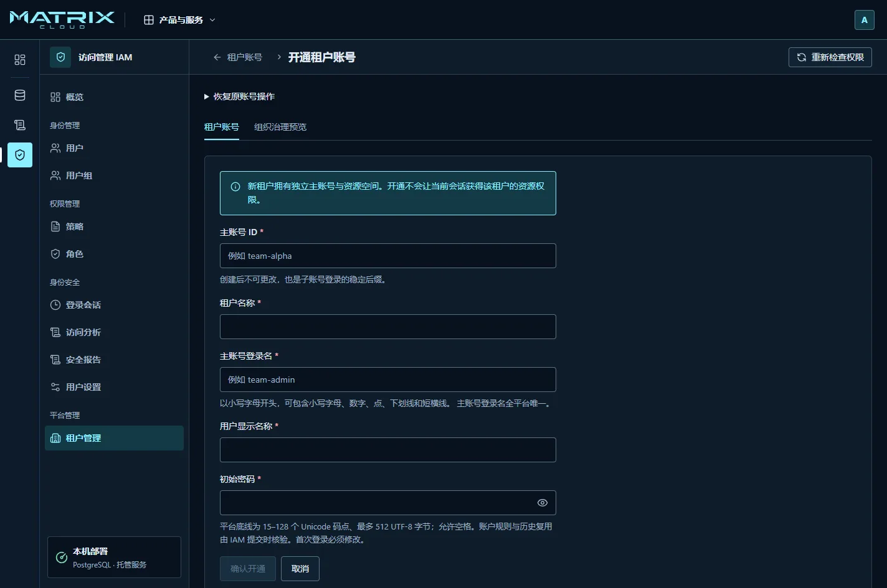
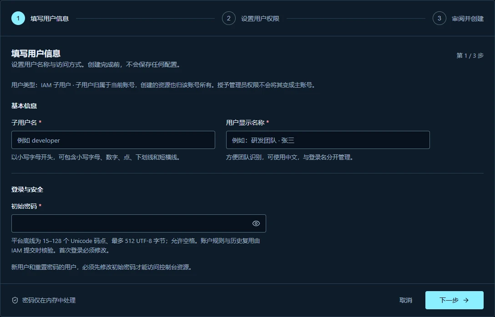
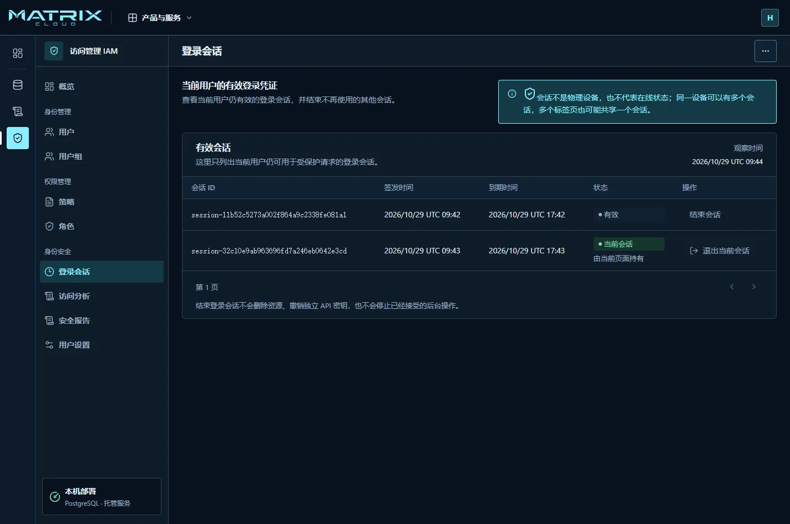
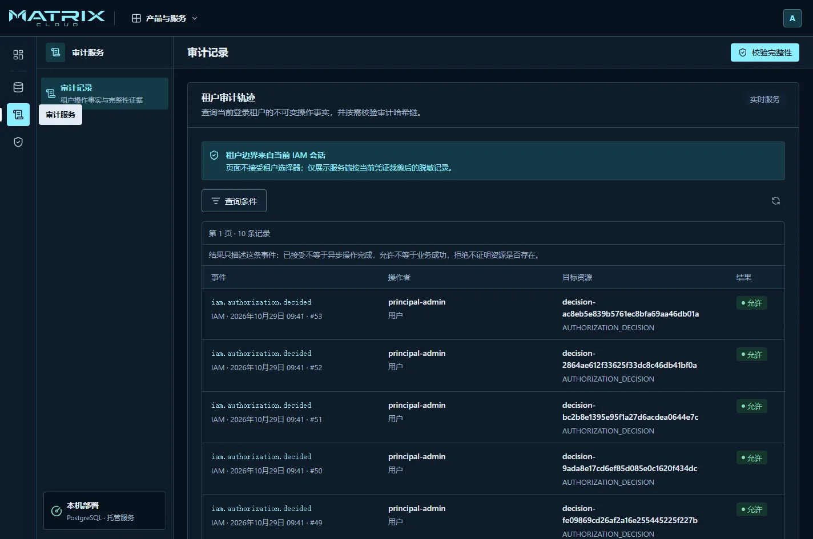

# 管理团队与保护账号

先确认自己正在操作正确的团队账号。不同身份可见的内容和可执行的操作不同；
看得到按钮也不代表已经获权，提交时仍以平台返回的结果为准。

## 开通一个团队账号

这一步由平台管理员执行。普通团队成员不需要重复开通。

1. 进入 **访问管理 IAM → 租户管理**，点击 **开通租户**。
2. 填写主账号 ID、租户名称、主账号登录名、显示名称和初始密码。
3. 仔细核对主账号 ID。它创建后不可更改，也是子账号登录时可使用的固定后缀。
4. 提交后，确认租户列表出现新账号，状态正常。
5. 通过团队认可的安全方式，将地址与登录材料分别交给账号所有者。

开通租户不会让平台管理员自动获得该租户的业务资源权限。
账号所有者还需按[首次使用](getting-started.md#3-完成首次改密)完成改密，才能开始工作。

## 创建团队成员

进入 **访问管理 IAM → 用户 → 创建用户**。

1. **填写用户信息**：填写子用户名、方便同事识别的显示名称和初始密码。
2. **设置用户权限**：按页面要求选择权限边界；只有页面允许时，主账号才可明确选择不设置。
   权限边界表示“最多能获得什么权限”，本身不授予权限。
3. **审阅并创建**：核对用户归属和填写内容，再提交。
4. 回到用户列表，打开该用户确认创建结果。
5. 将完整子账号登录名交给本人，例如 `xiaoli@team-account`，并提醒首次登录需要改密。

**当前创建流程只建立用户与初始密码，不同时绑定策略、加入用户组或签发访问密钥。**
不要把向导中的“设置用户权限”理解为已经给用户授予了业务权限。
本地用户是当前可用路径；企业目录导入、外部协作者和 SSO 不能按现成入职功能使用。

## 给成员授予工作所需权限

单个成员的例外授权，可从用户详情中的策略关联入口操作。
一组职责相同的成员，适合通过 **用户组** 统一维护成员关系和关联策略。

1. 先确定成员需要使用哪个产品、查看哪些资源、是否需要修改或删除。
2. 打开目标用户或用户组，查看已有策略来源。
3. 在关联策略的页面中阅读策略说明，选择满足任务的最小范围，再确认提交。
4. 让成员用自己的账号重新查看目标资源，并实际验证允许的操作。
5. 同时确认无关资源与敏感操作仍被拒绝。

例如，只需查看托管服务的成员可以由管理员审阅并关联 **PaaSViewer**：
在用户详情的 **关联策略** 中选择它，点击 **审阅关联 → 确认关联**。
让成员登录后查看实例；激活配额等写操作仍应被拒绝。需要管理服务时再评估其他权限，
不要为了消除一个拒绝提示就授予账号管理员权限。

用户列表中的“无直接关联策略”不表示完全没有权限：用户可能从用户组继承权限。
关联成功也不保证所有操作都允许，权限边界和明确拒绝仍然生效。
看到“资源已变化”时，重新读取并审阅当前状态，不重复提交旧表单。

### 调整成员职责或办理离职

职责调整时，先查看该用户的直接策略、组成员关系和角色承担范围，再撤销不再需要的部分。
不要只移除一个直接策略就认为全部权限已取消。

离职时，从用户详情按权限停用身份，并核查独立访问密钥和相关授权。
确认不再需要保留的访问关系后，再按页面提供的删除流程审阅影响范围。
当前真实用户列表未提供批量操作时，请逐个打开用户详情处理。

### 帮成员重置忘记的密码

1. 在用户列表打开目标成员，核对完整登录名与所属账号。
2. 点击 **重置密码**，设置新的临时密码，再点击 **审阅重置**。
3. 核对影响后点击 **确认重置密码**，等待“操作已完成”。
4. 通过安全渠道交付临时密码，让成员重新登录并设置自己的正式密码。
5. 确认成员可以读取原来获准的资源。重置会结束该成员的全部旧会话，不会自动解除停用状态。

成员在最后一步改密成功后直接进入控制台。重置结果不明确时，先核查原操作，
不要连续生成多个临时密码。

### 使用角色

角色用于临时承担一组职责。只有已经配置好信任与权限、且当前用户允许承担的角色才可使用。
按角色页面提示进入角色身份后，核对当前身份；结束工作时显式返回原用户。
角色失效后应重新判断权限，不应反复使用旧会话。
跨账号承担、外部身份信任和角色 SSO 不属于当前可直接使用的流程。

## 保护自己的账号

进入 **访问管理 IAM → 用户设置 → 本人安全**。
也可以从右上角账号菜单选择 **账号与权限**，再打开 **用户设置**。
按照页面提供的入口操作：

- **修改密码**：点击 **修改本人密码**，填写当前密码和新密码，核对是否结束其他会话。
  普通主动改密与首次强制改密的选项不同。
- **安全通知邮箱**：填写本人能够接收邮件的地址，完成验证码确认；更换地址时按页面完成验证。
  通知邮箱不是登录名，也不替代认证器。
- **认证器**：先验证安全通知地址，再按页面提示扫描二维码或输入设置材料，
  填写动态验证码完成绑定。安全保存一次性展示的恢复码，确认后按提示重新登录并验证动态码。
  不要把二维码、种子或恢复码截图放进工单。
- **更换或移除认证器**：先确认仍有可用验证方式，按页面要求完成再次验证。恢复码丢失且认证器不可用时，
  不要假设管理员一定能替你恢复所有身份，见[账号恢复](troubleshooting.md#密码或认证器不可用)。

如果这些入口显示不可用或需要其他权限，请按提示联系管理员。
不要把体验环境中的认证器演示当作真实绑定完成。

## 查看与结束登录会话

进入 **访问管理 IAM → 登录会话**。

- 当前页面使用的会话标记为 **当前会话**，通过正常退出结束。
- 不再使用的其他会话，可以点击 **结束会话**，再确认列表更新。
- 会话不等于一台设备，也不能证明对方此刻在线。
- 结束会话不等于删除资源、停止后台任务或停用独立访问密钥。

## 管理访问密钥

需要让程序调用平台时，在具备权限的普通用户详情中管理访问密钥。
主账号与角色不使用这条长期密钥创建路径。

1. 在创建页面核对所属用户，并填写获准的来源网络；不知道程序的出口地址时先让管理员确认。
2. 提交创建后，在一次性展示页安全保存 Secret，再完成页面确认。
3. 将密钥放入团队认可的秘密存储，不粘贴到网址、工单或代码仓库。
4. 轮换时先创建新密钥、更新程序并验证实际调用，然后停用旧密钥。
5. 确认旧密钥不再使用后再删除。停用与删除不同；删除不能撤销。

创建后关闭了秘密展示页，不能再从列表找回 Secret。
每名普通用户最多保留两把未删除的密钥，已停用的也占数量。
创建入口提示达到上限时，先确认哪把旧密钥已不再使用，再按权限停用、删除，腾出轮换位置。
若创建结果未知或响应丢失，先按页面恢复原操作；确认密钥已创建但秘密无法取得时，
按权限废弃它，再显式创建新密钥。不要反复点击创建。

## 查阅操作记录

从 **审计服务** 查询当前账号可见的记录，按时间与操作定位，并记录请求或事件编号。
点击记录可查看详情；需要核对记录完整性时，使用页面的 **校验完整性**。
校验结果只覆盖页面给出的区间，不代表所有业务操作都成功。

页面出现读取错误时，不能把空白结果解释为“没有发生操作”；
请按[读取失败](troubleshooting.md#页面没有数据或提示无法读取)处理。

更详细的权限和凭据边界分别由
[IAM 功能文档](../features/iam/README.md)维护；本页不要求普通用户编写策略 JSON 或调用接口。
