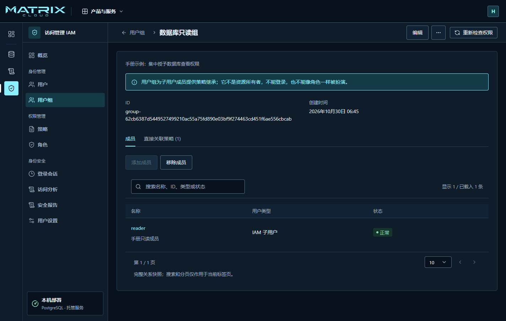
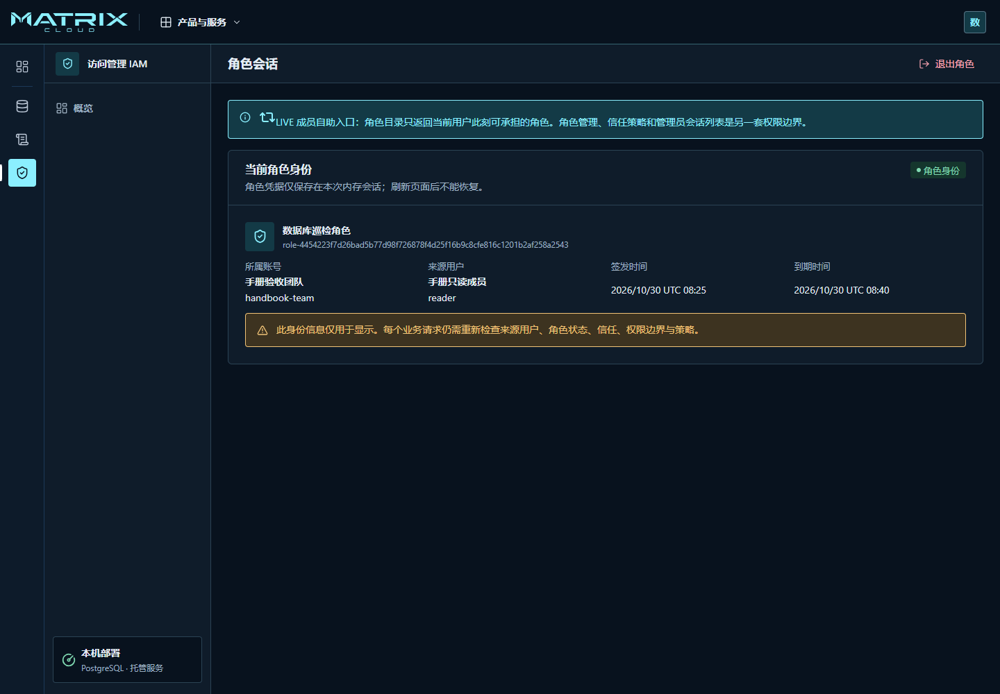
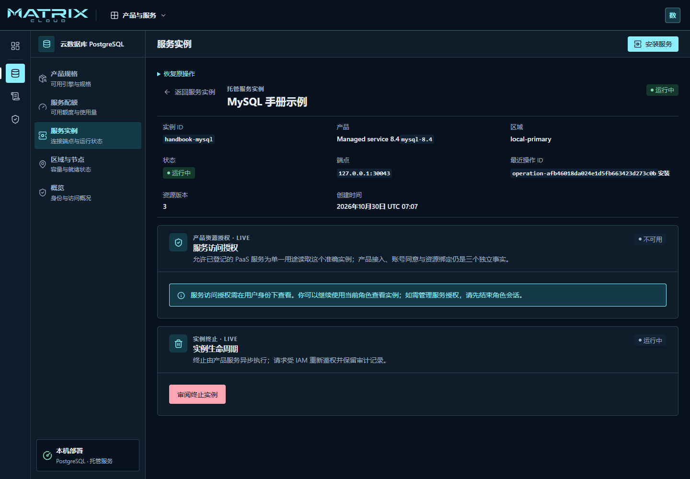
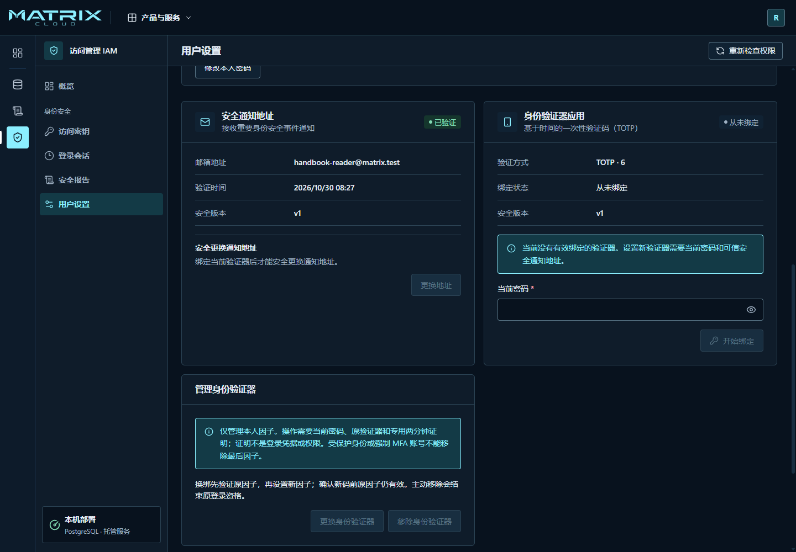
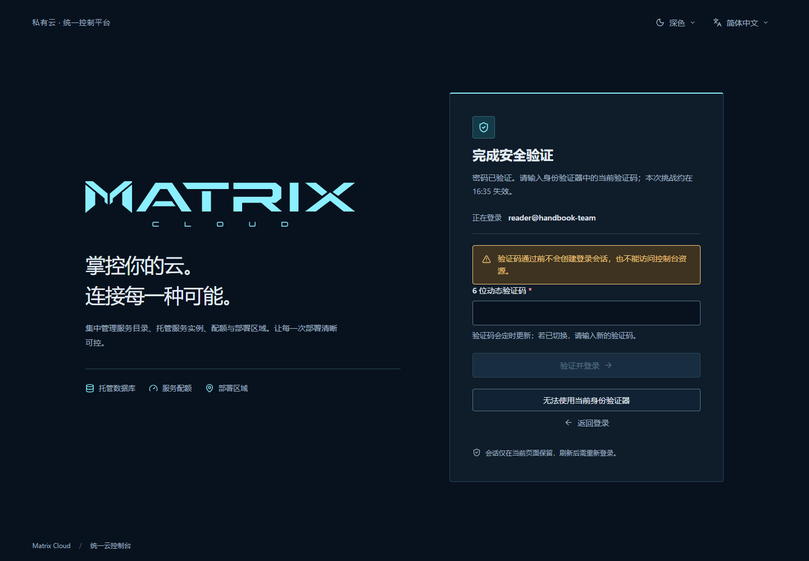
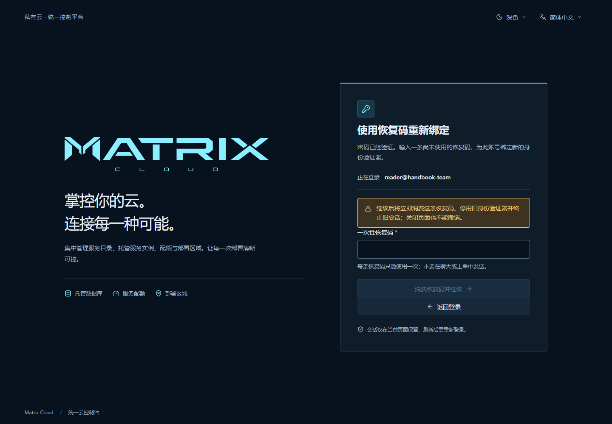
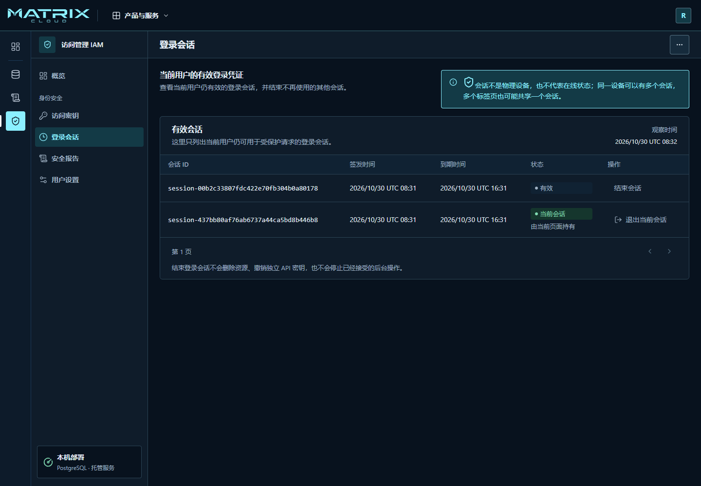
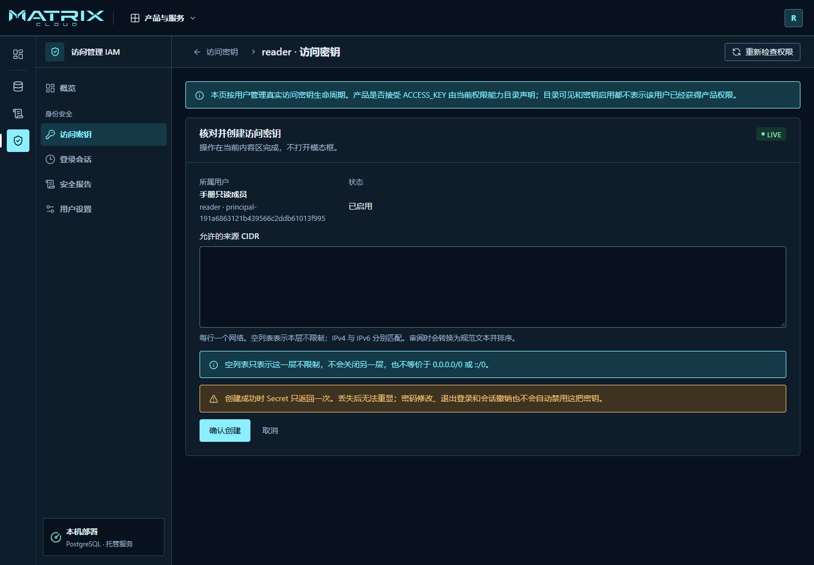
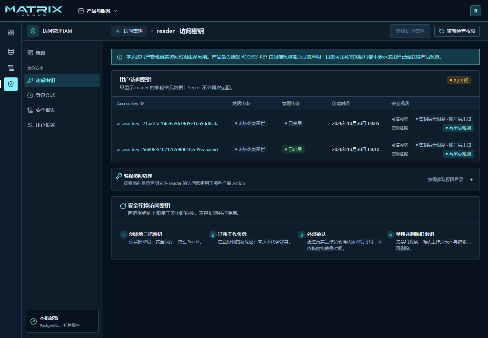

# 管理团队与保护账号

先确认自己正在操作正确的团队账号。不同身份可见的内容和可执行的操作不同；
看得到按钮也不代表已经获权，提交时仍以平台返回的结果为准。

## 开通一个团队账号

这一步由平台管理员执行。普通团队成员不需要重复开通。

1. 进入 **访问管理 IAM → 租户管理**，点击 **开通租户**。
2. 填写主账号 ID、租户名称、主账号登录名、显示名称和初始密码。
3. 仔细核对主账号 ID。它创建后不可更改，也是子账号登录时可使用的固定后缀。
4. 提交后，确认租户列表出现新账号，状态正常。
5. 通过团队认可的安全方式，将地址与登录材料分别交给账号所有者。

开通租户不会让平台管理员自动获得该租户的业务资源权限。
账号所有者还需按[首次使用](getting-started.md#3-完成首次改密)完成改密，才能开始工作。

## 创建团队成员

进入 **访问管理 IAM → 用户 → 创建用户**。

1. **填写用户信息**：填写子用户名、方便同事识别的显示名称和初始密码。
2. **设置用户权限**：按页面要求选择权限边界；只有页面允许时，主账号才可明确选择不设置。
   权限边界表示“最多能获得什么权限”，本身不授予权限。
3. **审阅并创建**：核对用户归属和填写内容，再提交。
4. 回到用户列表，打开该用户确认创建结果。
5. 将完整子账号登录名交给本人，例如 `xiaoli@team-account`，并提醒首次登录需要改密。

**当前创建流程只建立用户与初始密码，不同时绑定策略、加入用户组或签发访问密钥。**
不要把向导中的“设置用户权限”理解为已经给用户授予了业务权限。
本地用户是当前可用路径；企业目录导入、外部协作者和 SSO 不能按现成入职功能使用。

## 给成员授予工作所需权限

单个成员的例外授权，可从用户详情中的策略关联入口操作。
一组职责相同的成员，适合通过 **用户组** 统一维护成员关系和关联策略。

1. 先确定成员需要使用哪个产品、查看哪些资源、是否需要修改或删除。
2. 打开目标用户或用户组，查看已有策略来源。
3. 在关联策略的页面中阅读策略说明，选择满足任务的最小范围，再确认提交。
4. 让成员用自己的账号重新查看目标资源，并实际验证允许的操作。
5. 同时确认无关资源与敏感操作仍被拒绝。

例如，只需查看托管服务的成员可以由管理员审阅并关联 **PaaSViewer**：
在用户详情的 **关联策略** 中选择它，点击 **审阅关联 → 确认关联**。
让成员登录后查看实例；激活配额等写操作仍应被拒绝。需要管理服务时再评估其他权限，
不要为了消除一个拒绝提示就授予账号管理员权限。

用户列表中的“无直接关联策略”不表示完全没有权限：用户可能从用户组继承权限。
关联成功也不保证所有操作都允许，权限边界和明确拒绝仍然生效。
看到“资源已变化”时，重新读取并审阅当前状态，不重复提交旧表单。

### 示例：通过用户组授予只读权限

当多人承担相同工作时，用用户组维护一次授权，减少逐人调整的遗漏。
下面以成员 `reader` 和 **数据库只读组** 为例。

1. 进入 **用户组 → 新建用户组**，填写名称与描述，点击 **下一步 → 新建用户组**。
   创建成功时还是空组，没有成员，也没有策略。
2. 点击 **查看用户组**，在 **成员** 标签页点击 **添加成员**。
3. 选中 `reader`，点击 **审阅变更**，核对目标后 **确认变更**。回到详情确认成员出现。
4. 打开 **直接关联策略** 标签页，点击 **关联策略**，选择 **PaaSViewer**。
   点击 **审阅变更 → 确认变更**，核对关联策略数量与名称。
5. 让成员用自己的账号登录，打开服务实例列表，再打开一个实例详情确认可读取。
   只读权限不包含配额激活、安装或终止实例的许可。

`PaaSViewer` 还允许读取当前账号的应用、配置和部署等信息，并非仅限数据库。
只允许查看数据库实例时，应由管理员使用下一节角色示例中的实例读取策略，按需限定资源。

成员可以同时有直接授权和组授权。验证组授权时，使用没有重复直接授权的测试成员，
确认其能够读取 PostgreSQL 与 MySQL 实例。不要为了照抄示例就删除别人的已有授权，
应先审阅其用途。

**成员调岗时**，在组详情点击 **移除成员**，选择目标并完成 **审阅变更 → 确认变更**。
移除成员不会删除用户或数据库。让成员重新读取原来可访问的实例：如果这是唯一的
授权来源，新的读取应被拒绝；重新加入后，再读取应恢复。
原页面已显示的内容可能仍是之前的读取结果，不能仅凭旧列表判断撤权是否生效。

### 调整成员职责或办理离职

职责调整时，先查看该用户的直接策略、组成员关系和角色承担范围，再撤销不再需要的部分。
不要只移除一个直接策略就认为全部权限已取消。

离职时，从用户详情按权限停用身份，并核查独立访问密钥和相关授权。
确认不再需要保留的访问关系后，再按页面提供的删除流程审阅影响范围。
当前真实用户列表未提供批量操作时，请逐个打开用户详情处理。

### 帮成员重置忘记的密码

1. 在用户列表打开目标成员，核对完整登录名与所属账号。
2. 点击 **重置密码**，设置新的临时密码，再点击 **审阅重置**。
3. 核对影响后点击 **确认重置密码**，等待“操作已完成”。
4. 通过安全渠道交付临时密码，让成员重新登录并设置自己的正式密码。
5. 确认成员可以读取原来获准的资源。重置会结束该成员的全部旧会话，不会自动解除停用状态。

成员在最后一步改密成功后直接进入控制台。重置结果不明确时，先核查原操作，
不要连续生成多个临时密码。

### 示例：临时承担数据库巡检角色

角色适合临时工作。成员仍用自己的账号登录，再切换到角色，不需要领取另一套密码。
下面的角色只允许读取数据库实例，最长使用 15 分钟。

**由管理员先准备**：

1. 在 **策略 → 新建自定义策略 → 可视化编辑** 创建 **数据库巡检权限**。
   选择 `managedservice · SERVICE_INSTALLATION`，只选
   `managedservice.service-installation.read`；本例的资源范围为当前账号内全部实例。
   审阅后确认创建。实际工作可以改为指定实例，不能只凭策略名称判断权限。
2. 进入 **角色 → 新建角色**，选择被信任的成员 `reader`，再填写
   **数据库巡检角色**、用途和 **15 分钟**，审阅并创建。
3. 打开角色详情，分别通过 **修改权限边界** 和 **关联策略** 选择刚才的巡检策略，
   完成各自审阅与确认。权限边界只是上限，关联策略才提供允许的操作；两步缺一不可。
4. 再创建 **承担数据库巡检角色** 策略：选择 `iam · ROLE` 的 `iam.role.assume`，
   资源选 **精确 ID**，填入该角色详情显示的角色 ID。
5. 在 `reader` 的用户详情关联这条承担策略。被列为可信成员，不等于已经获准承担。

**由成员开始使用**：

1. 用自己的子账号登录，从右上角账号菜单选择 **角色会话**。
2. 找到 **数据库巡检角色**，点击 **审阅并承担**，核对角色、账号与时长，再点 **承担角色**。
3. 确认页面显示 **当前角色身份**，来源用户是自己，到期时间符合预期。
4. 打开服务实例，读取 MySQL 或 PostgreSQL 详情。其他目录可能提示没有权限，
   因为本例只授予实例读取；不要为消除提示扩大角色权限。
5. 完成后在角色会话页点 **退出角色**，或在账号菜单点 **结束当前角色会话**。
   等待来源用户验证成功，再继续普通用户的工作。

看不到可承担角色时，请管理员分别检查可信成员、承担许可、角色自身策略和权限边界。
角色到期或被撤销后，用 **验证并返回用户模式** 返回；来源用户也失效时才重新登录。
刷新页面不能恢复内存中的角色凭据，需要按页面重新建立会话。
实例详情中的 **服务访问授权** 需返回用户身份查看，这不会增加或取消数据库读取权限。
跨账号承担、外部身份信任和角色 SSO 不属于当前流程。

## 保护自己的账号

进入 **访问管理 IAM → 用户设置 → 本人安全**。
也可以从右上角账号菜单选择 **账号与权限**，再打开 **用户设置**。

### 先验证安全通知邮箱

1. 在 **安全通知地址** 填写自己能收信的邮箱和当前密码，点 **发送验证码**。
2. 打开该邮箱，找到本次验证邮件。回到页面填写 **8 位邮箱验证码**，点 **验证通知地址**。
3. 确认页面显示 **已验证**，邮箱地址正确，再继续绑定认证器。

邮箱用于安全通知，不是登录名，也不能代替动态码或恢复码。
收不到邮件时先核对地址、垃圾邮件和页面发送状态；联系部署人员检查邮件服务，
不要连续重复发送。图中地址属于本地测试邮箱，实际使用时填写自己的地址。

### 绑定认证器并验证登录

1. 准备能够生成 6 位动态验证码的认证器应用。
2. 在 **身份验证器应用** 输入当前密码，点击 **开始绑定**。
3. 用认证器扫描页面二维码，或将页面提供的设置密钥手动加入认证器。
   将这个条目标记为对应的 Matrix 账号，避免以后选错。
4. 填入认证器当前显示的 **6 位动态验证码**，点击 **验证并完成绑定**。
5. 安全保存一次性展示的 **10 条恢复码**，与认证器分开保管。
   勾选已保存，点 **完成并重新登录 → 返回登录**。二维码、设置密钥和恢复码不要截图上传。
6. 再用完整登录名与密码登录；出现 **完成安全验证** 后，输入新的动态码，点 **验证并登录**。
   刚用于绑定的验证码不能重复使用，等认证器更新后再输入。
7. 进入控制台后，在本人安全页确认状态为 **已绑定**。

绑定会结束旧登录会话。看到成功页后应重新登录，不是绑定失败。
提示验证码错误、已使用或操作受限时，先核对账号条目和设备时间，等待新的验证码；
反复尝试、刷新或重新登录不会清除服务端的尝试限制。页面验证期限已过时，从登录重新开始。

### 认证器丢失，但仍有恢复码

恢复码用于重新绑定认证器，不能作为长期替代验证码；仍然需要当前登录密码。

1. 在登录页输入完整登录名和密码。
2. 在 **完成安全验证** 页点击 **无法使用当前身份验证器**。
3. 在 **使用恢复码重新绑定** 页填入一条尚未使用的恢复码，点 **消费恢复码并继续**。
4. 按新页面为认证器添加新的设置，输入 **新身份验证器的 6 位验证码**，
   点 **确认新身份验证器**。此时只允许完成恢复，还没有普通登录会话。
5. 安全保存新的一组恢复码。恢复成功后，原恢复码批次不再可用；以后使用新材料。
6. 勾选已保存，按 **完成并重新登录 → 返回登录** 继续，用密码和新认证器的新动态码登录。
7. 进入本人安全页确认 **已绑定**；旧页面应重新登录。

消费恢复码后，旧认证器和旧会话会被结束。中途断线时先核查原恢复结果；
不要把恢复码已消费误当成“什么都没有发生”，也不要反复使用同一条码。
新绑定已成功但没有保存到新恢复码时，先用新认证器重新登录，再按页面的恢复码管理入口处理。
恢复码与认证器都不可用时，按[账号恢复](troubleshooting.md#密码或认证器不可用)联系负责人员。

### 日常修改密码或更换认证器

- **修改密码**：点 **修改本人密码**，填写当前密码和新密码，核对是否结束其他会话。
  普通主动改密与首次强制改密的选项不同。
- **仍能使用旧认证器时换机**：使用 **更换身份验证器**，按页面完成当前密码与原动态码验证，
  再设置新认证器。确认新码前，保留原认证器；不要误用丢失恢复入口。
- **移除认证器**：按 **移除身份验证器** 的验证与影响提示操作。
  受保护身份或账号要求 MFA 时，不能移除最后的验证方式。

入口不可用时按提示联系管理员，不把体验环境的演示结果当作真实修改完成。

## 查看与结束登录会话

进入 **访问管理 IAM → 登录会话**。

1. 从 **更多操作 → 刷新会话** 读取最新列表，核对签发时间与 **当前会话** 标记。
2. 找到不再使用的另一条会话，点 **结束会话 → 确认结束**。
3. 确认它从有效列表消失。另一页面下次请求应要求重新登录，当前页面继续可用。
4. 需要一次结束所有其他会话时，使用 **更多操作 → 结束其他会话**，阅读影响再确认。
5. 当前页面通过 **退出当前会话** 或账号菜单中的退出登录结束。

会话不等于一台设备，也不能证明对方此刻在线。结束会话不会删除资源、停止已经接受的
后台任务或停用独立访问密钥。已经显示在另一页面上的旧内容也不会因此自动被擦除。

## 管理访问密钥

需要让程序调用平台时，在具备权限的普通用户详情中管理访问密钥。
主账号与角色不使用这条长期密钥创建路径。
已获本人密钥管理权限的成员，也可从 **访问管理 IAM → 访问密钥** 进入。
维护密钥和调用业务需要各自的授权；主账号身份或“这是我自己的密钥”都不替代授权。

本例由管理员先用 **策略 → 新建自定义策略 → 可视化编辑** 准备密钥维护权限，
在 `reader` 的用户详情关联后再交给本人操作。创建与列出密钥的目标选该普通用户；
查看、启停和删除的目标选获准维护的访问密钥范围。另行关联 **AuditReader** 才能完成
本例的审计读取验证；实际程序应换成它工作所需的业务权限。

### 创建与首次调用

1. 点击 **新建访问密钥**，核对所属用户。填写管理员确认的来源网络，每行一个；
   不知道程序出口地址时先确认，不能照抄截图中的空列表。空列表只表示密钥这一层不限制。
2. 点 **确认创建**。在一次性展示页同时保存 **Access key ID** 和 **Secret**，
   勾选已安全保存后点 **已完成**。秘密页面不要截图或放进工单。
3. 在程序的秘密配置中填入材料，执行它实际需要的调用，并检查返回结果。
   密钥不会自动授予业务权限；要同时满足产品支持与用户授权。
4. 回到密钥详情核对状态，必要时重新检查权限。**最近授权观测** 是历史记录，
   不能代替当前程序调用的结果。

本例用获准的审计读取验证密钥。访问密钥不是 MySQL 登录密码，
也不能假定控制台里出现的所有接口都接受它。

### 轮换、停用与删除

1. 保留旧密钥，按上面的流程创建第二把，安全保存新材料。
2. 在实际程序中换用新密钥，确认真实请求成功。仅看列表“已启用”不够。
3. 打开旧密钥详情，点击 **禁用**，核对 ID 和影响，再点击 **禁用** 确认。
4. 确认程序仍正常；用旧密钥发起的新请求应被拒绝。需要回退时，尚未删除的旧密钥
   可在具有权限、用户状态允许的情况下重新启用。
5. 确认没有程序再使用旧密钥后，从详情的 **更多操作 → 删除** 进入，
   勾选已确认不再使用，再点 **确认删除**。返回列表确认旧密钥已移除。

删除无法撤销。退出控制台、结束登录会话或普通修改密码，都不会自动停用独立密钥。
疑似泄露时，直接处理对应密钥，不能只改登录密码。

创建后关闭了秘密展示页，不能再从列表找回 Secret。
每名普通用户最多保留两把未删除的密钥，已停用的也占数量。
创建入口提示达到上限时，先确认哪把旧密钥已不再使用，再按权限停用、删除，腾出轮换位置。
若创建结果未知或响应丢失，先按页面恢复原操作；确认密钥已创建但秘密无法取得时，
按权限废弃它，再显式创建新密钥。不要反复点击创建。

## 查阅操作记录

从 **审计服务** 查询当前账号可见的记录，按时间与操作定位，并记录请求或事件编号。
点击记录可查看详情；需要核对记录完整性时，使用页面的 **校验完整性**。
校验结果只覆盖页面给出的区间，不代表所有业务操作都成功。

页面出现读取错误时，不能把空白结果解释为“没有发生操作”；
请按[读取失败](troubleshooting.md#页面没有数据或提示无法读取)处理。

本页示例的真实页面验证与限制见
[IAM 手册复核记录](../features/iam/FEAT-IAM-010-console.md#用户手册的团队授权与凭据复核)。
更详细的权限和凭据边界由 [IAM 功能文档](../features/iam/README.md)维护。
