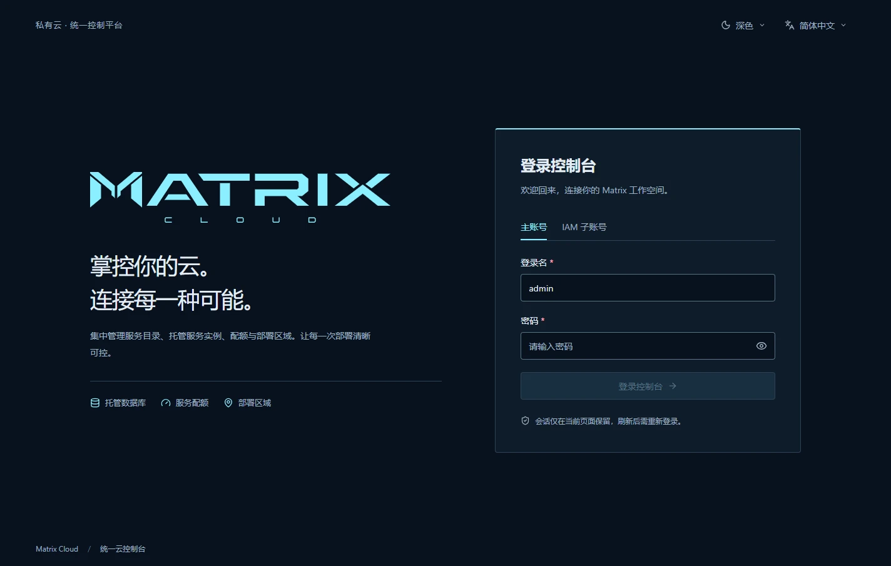
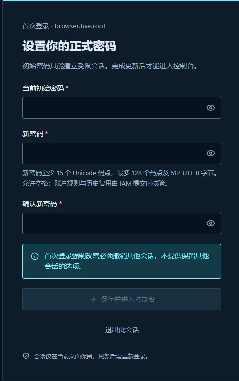
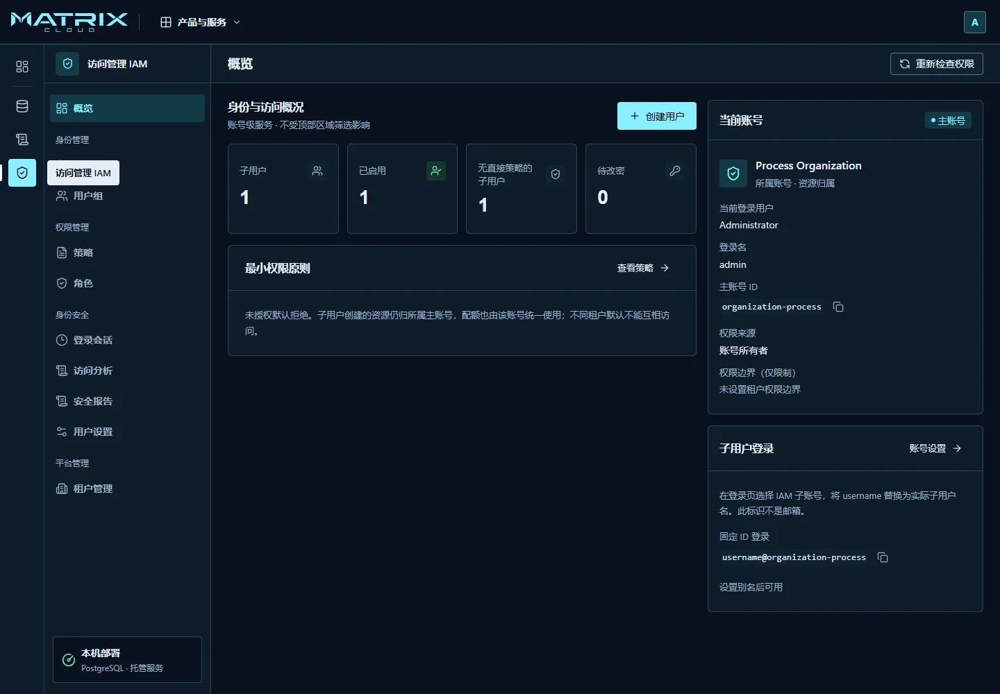

# 开始使用 Matrix

Matrix 帮助团队在自己的基础设施上管理账号、申请托管服务和查看应用。
普通成员从浏览器开始；只有负责平台的运维人员需要执行安装命令。

## 先确认你拿到的环境

向管理员领取三样东西：**控制台地址、完整登录名、初始密码**。
请使用管理员交付的入口，不要自行猜测端口或将 HTTP 地址改为 HTTPS。

看到 **MOCK／体验环境／模拟数据** 时，你正在使用演示界面。
其中的资源、监控图表、日志和操作结果不能代表真实平台。
本手册的截图来自主线自带的界面，在隔离环境中连接真实服务拍摄，使用示例账号。

> **先确认平台已经装好。** 当前主线还没有通过本次本机 Docker 安装验证。
> 运维人员应先核对[安装结果与交付限制](../features/FEAT-005-offline-platform-lifecycle.md#当前主线本机-docker-安装复核)，
> 再交付可用地址。本手册的页面截图不代表一套新环境已完成从安装到恢复的验证。

> **当前主线的首次登录存在阻塞。** 新账号进入改密页后，开始输入可能直接回到登录页。
> 本次真实页面复核已复现此问题。交付管理员应先提供通过首次登录验证的版本，再发放新账号。
> 不要反复重置密码、取消强制改密，或用数据库修改来绕过。
> 具体影响和证据由 [IAM 控制台功能记录](../features/iam/FEAT-IAM-010-console.md#当前主线首次改密阻塞)维护。

## 1. 安装平台，或直接领取账号

- **普通成员**：平台已安装时，直接进入下一步。
- **平台运维人员**：先完成[安装与检查](../runbooks/platform-installation.md#安装平台)，
  确认平台就绪，再交付地址与初始管理身份。
  使用 Windows 与 Docker Desktop 时，先阅读[环境说明](../runbooks/platform-installation.md#windows-与-docker-desktop)，
  不直接在 PowerShell 中运行 Linux 安装命令。
- **团队管理员**：需要独立团队空间时，由平台管理员开通租户账号；
  你在自己的账号内创建成员，不需要为每名成员新建一个租户。

Linux 的 root 用户负责安装；Matrix 的主账号负责平台内的资源与权限。
两者的密码不通用。

## 2. 选择正确的登录方式

1. 打开管理员提供的控制台地址。
2. 使用账号所有者身份时，选择 **主账号**，填写主账号登录名。
3. 使用团队成员身份时，选择 **IAM 子账号**，填写完整标识，
   例如 `xiaoli@team-account`。后半部分由管理员提供，是账号 ID 或已经设置的账号别名。
4. 输入密码，点击 **登录控制台**。

`用户名@账号` 不是邮箱。不要把邮箱、显示名称或另一个团队的账号后缀当作登录名。
当前真实登录流程不提供企业 SSO、扫码登录或外部协作者身份选择。

## 3. 完成首次改密

新账号以及被管理员重置密码的用户，登录后应先进入 **设置你的正式密码**。
该页面完成之前，不能正常使用控制台资源。上方所述主线阻塞未解除时，请停在此步骤联系管理员。

在已通过首用验证的交付版本中：

1. 填写领取的初始密码。
2. 设置自己的新密码，再输入一次确认。按页面提示满足密码规则，推荐使用不重复的长口令。
3. 点击 **保存并进入控制台**。
4. 确认进入控制台后，保存好新密码并停止使用初始密码。

首次改密会撤销该用户的其他登录会话。不要把密码、验证码或恢复码写进工单、截图和聊天记录。

## 4. 核对自己在哪个账号里

打开 **访问管理 IAM → 概览**，确认“当前账号”“当前登录用户”和“主账号 ID”。
主账号拥有团队资源；普通成员获得管理权限后仍是成员，不会变成主账号。

同一团队的成员共享该账号的资源归属与配额，但各自能看的页面、能做的操作可能不同。
没有某个菜单或按钮时，先确认当前身份与权限，不要通过切换账号后缀尝试访问其他团队。

## 5. 完成第一件工作

- 管理员：[创建成员并授予所需权限](access-management.md#创建团队成员)。
- 服务使用者：[开通服务、配置配额并申请实例](services-and-applications.md#申请第一个托管服务)。
- 应用使用者：[查看已有应用](services-and-applications.md#查看应用与交付进度)。
- 遇到拒绝、空页面或结果不明：[按现象处理](troubleshooting.md)。

## 6. 结束使用

从右上角账号菜单正常退出。刷新页面或重新打开标签页后，可能需要重新登录：
当前控制台只在页面内存中保留登录凭据，不通过 Cookie、本地存储或网址保存它。

退出登录不会停止已经被平台接受的后台任务。稍后重新登录，应到原资源页面查看结果，
不要因为关过页面就重新创建同一个实例。

更换密码、绑定认证器和结束其他登录会话，见[账号安全](access-management.md#保护自己的账号)。
