# 使用托管服务与查看应用

先检查当前登录的账号，确认你有目标服务的使用权限。
服务是否已经开通、你的操作权限、可用配额和实例运行状态，是四件不同的事。

## 申请第一个托管服务

下面以 PostgreSQL 为例；另有一条[MySQL 实例示例](#示例安装并连接-mysql)。
Elasticsearch 和 RabbitMQ 从各自服务入口开始，按平台实际提供的规格操作。
实例里要保存真实业务数据前，先与运维人员确定数据备份和恢复方案。

### 第一步：打开服务并确认开通状态

1. 从 **产品与服务** 找到目标服务；也可以从 **产品规格** 的“进入服务”进入。
2. 如果页面显示 **未开通**，由有开通权限的人员点击 **开通服务**。
3. 等待页面进入产品概览。此时服务在当前租户范围内开通，团队成员不必逐人重复开通。

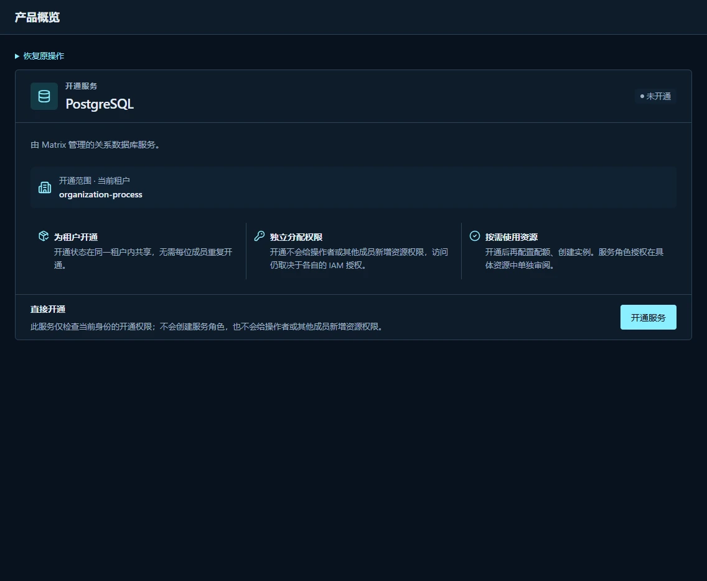

开通服务不会自动创建实例，也不会给所有成员授予资源权限。
看得到服务但不能创建资源时，请管理员核对具体操作权限。

### 第二步：配置配额

1. 进入该服务的 **配额** 页面，点击 **激活配额**。
2. 选择服务产品、资源规格和需要的实例数量。
3. 核对后点击 **确认激活配额**。
4. 确认配额列表出现对应规格，并查看可用数量。

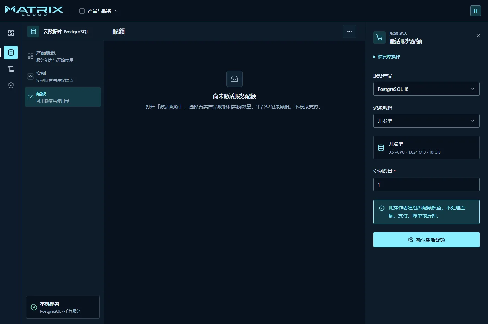

配额是当前账号可申请的额度，不是已经创建的实例。
这里不处理付款、账单或折扣；不要把激活成功当作支付成功。

### 第三步：提交实例安装

1. 进入 **实例** 页面，点击 **安装服务**。
2. 填写唯一的实例 ID 和容易识别的显示名称。
3. 选择仍有可用数量的配额，以及页面提供的安装区域。
4. 核对后点击一次 **提交安装任务**，等待平台回执。

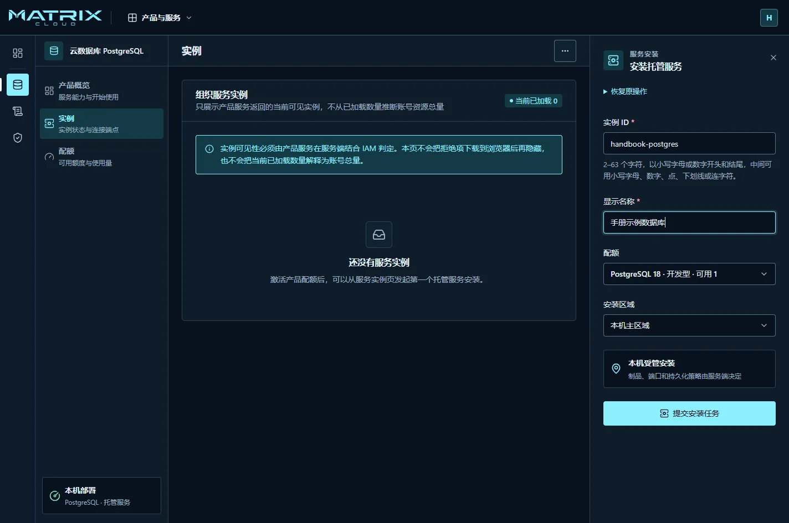

实例 ID 请按输入框提示填写。资源规格、制品、端口和存储方式由平台提供，
当前流程没有上传任意镜像或填写任意部署模板的入口。

### 第四步：等待就绪

返回实例列表，打开目标实例，查看状态、操作编号与连接端点。
**提交被接受只表示任务已经进入处理，不代表服务已经可连接。**

- 处理中：留在原实例页面查看后续状态，不再创建同名实例。
- 运行中：再进入连接验证。
- 失败：保留实例 ID、操作编号和页面错误码，请运维人员检查；先确认原任务结果，再决定下一步。
- 结果未知或页面断线：使用页面的 **恢复原操作**，见[恢复未知结果](troubleshooting.md#提交后断线或显示结果未知)。

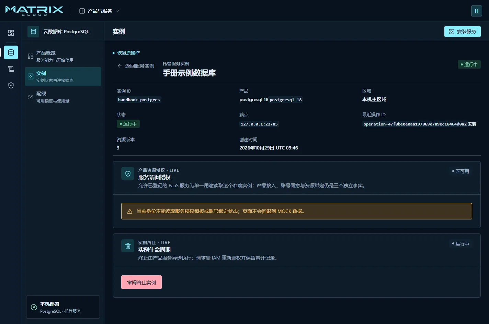

### 第五步：连接与验证

1. 从实例详情核对平台返回的端点及所属区域。
2. 请管理员确认你的应用所在网络能够到达该端点。`127.0.0.1` 指服务所在主机，
   不是你正在使用的任意一台电脑；远程访问前须由管理员安排连接方式。
3. 向负责该服务的管理员取得获准的业务连接方式与凭据交付方案。
4. 用测试数据完成一次连接验证，再接入业务。

控制台不会直接显示数据库明文密码，凭据引用也不是可以当作密码使用的内容。
目前没有通用的“查看密码／复制完整连接串”用户流程。
**只有端点、没有完成凭据与网络交付时，不应承诺应用已经可以使用数据库。**
Matrix 的登录密码、访问密钥和数据库业务密码也不能混用。

## 示例：安装并连接 MySQL

下面用一个小型测试实例走完“开通 → 配额 → 安装 → 连接”的流程。
示例名称可以替换，实例 ID 必须在自己的账号内唯一。

### 1. 开通 MySQL 并准备一个实例的配额

1. 打开顶部 **产品与服务 → MySQL**。页面仍在读取状态时，先等待加载完成。
2. 尚未开通时点击 **开通服务**；已经开通时直接继续。
3. 点击 **配置配额**，再点击 **激活配额**。
4. 服务产品选 **MySQL 8.4 LTS**，规格选 **开发型**，实例数量填 `1`，提交 **确认激活配额**。
5. 确认配额显示“已激活 1、可用 1”。开发型适合本示例；业务使用前应由管理员确认规格。

### 2. 安装示例实例

进入 MySQL 的 **实例** 页面，等权限检查完成后点击 **安装服务**。
也可以从控制台首页的通用 **服务实例** 页面打开同一安装表单；下图使用这个入口。

| 填写项 | 本例选择 |
| --- | --- |
| 实例 ID | `handbook-mysql` |
| 显示名称 | `MySQL 手册示例` |
| 配额 | **MySQL 8.4 LTS · 开发型** |
| 安装区域 | **本机主区域** |

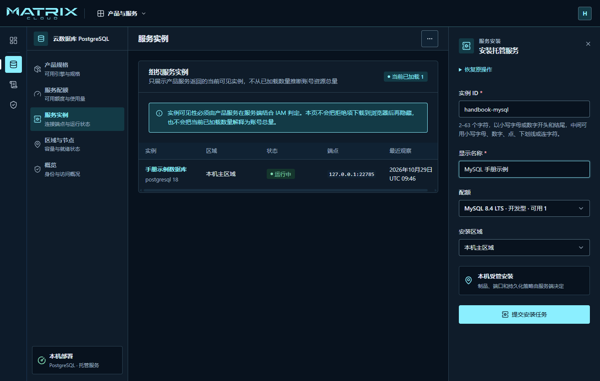

核对配额确实属于 MySQL，再点击一次 **提交安装任务**。
返回实例列表，打开 **MySQL 手册示例**，等待状态成为 **运行中**。
不要将“平台已接受”当作已经安装成功。

### 3. 取得连接材料并验证

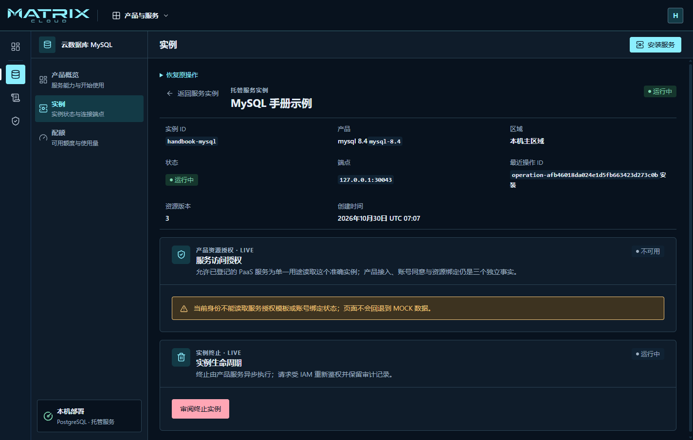

向管理员领取业务连接材料，在团队使用的数据库客户端中填写：

| 连接项 | 如何填写 |
| --- | --- |
| 数据库类型 | MySQL |
| 地址和端口 | 以你自己的实例详情为准；截图中的端口只是本例结果 |
| 数据库名 | 本交付组合的业务库为 `service`，由管理员确认 |
| 用户名和密码 | 使用管理员交付的业务账号；本例使用 `matrix_service` |

本机截图中的 `127.0.0.1` 不适用于任意远程电脑。先确认客户端到实例的网络路径，
再测试连接。密码由管理员安全交付，控制台的凭据引用不能当作密码使用。

连接成功后，在这个测试实例中新建一张测试表、写入一条测试数据，再查询确认内容一致。
三步都成功后，再把连接交给应用使用。仅看到绿色“运行中”还不能替代自己的连接验证。
实例详情下方的 **服务访问授权** 是平台服务的受托权限，不是数据库连接密码。

日常可以重新打开实例详情核对状态和端点。用完测试实例后，按
[终止实例](#不再使用一个实例)核对数据和影响，再决定是否释放资源。
本例的真实运行与验证范围见[界面复核记录](../features/FEAT-007-control-plane-console.md#用户手册界面复核)。

### 多个团队使用时

独立团队需要使用独立租户账号开通实例。一个租户下创建两个 IAM 成员，并不会得到
两个独立租户；成员能做什么仍由该租户的授权决定。每个实例使用自己的连接地址和
业务密码，不要复用另一团队的连接材料。

需要独立物理主机或虚拟机时，应在交付前明确提出；创建两个容器不等于满足这一要求。
应用与数据库之间是否能连接也需要管理员确认，不能从“都在 Matrix 中”推断网络互通。
新隔离实现的适用版本、迁移影响和实际验收见
[MySQL 租户隔离](../features/FEAT-007-control-plane-console.md#docker-mysql-租户隔离)。

维护后先用自己实例的原连接材料读取一条已知数据，再恢复应用连接。
连接失败时提供实例 ID、操作编号和发生时间，请管理员检查；不要反复安装新实例。
经运维停止的实例由管理员按[恢复流程](../runbooks/platform-installation.md#恢复经运维停止的-mysql-实例)处理。

## 示例：接入并验证 Logstash

本例用于已经包含 Logstash 的交付包。它接收带业务账号认证的 JSON 日志，并将事件
保存在实例内。使用前先与管理员确认日志保留和备份要求。

### 1. 开通并准备配额

1. 从 **产品与服务** 搜索 **Logstash**，进入后点击 **开通服务**。
2. 打开 **配额 → 激活配额**，选择 **Logstash 8.19 · 开发型**，实例数量填 `1`。
3. 确认出现可用配额，再进入 **实例 → 安装服务**。

### 2. 创建实例并等待运行

| 填写项 | 本例选择 |
| --- | --- |
| 实例 ID | `handbook-logstash-check` |
| 显示名称 | `Logstash 接入示例` |
| 配额 | **Logstash 8.19 · 开发型** |
| 安装区域 | **本机主区域** |

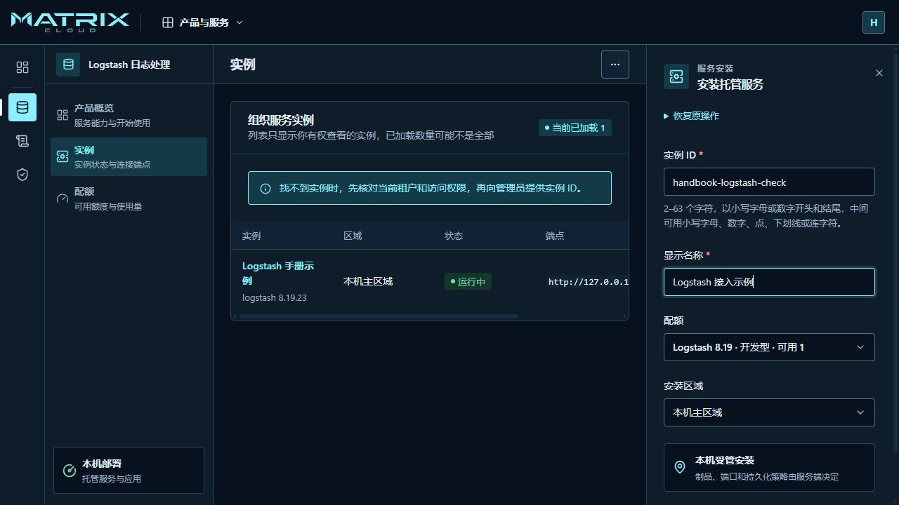

提交一次 **安装任务**，打开实例详情，等待状态从“安装中”更新为“运行中”。
等待期间不要再次创建同名实例；页面断线时，先按[恢复原操作](troubleshooting.md#提交后断线或显示结果未知)
核对原任务。

### 3. 发送一条测试日志

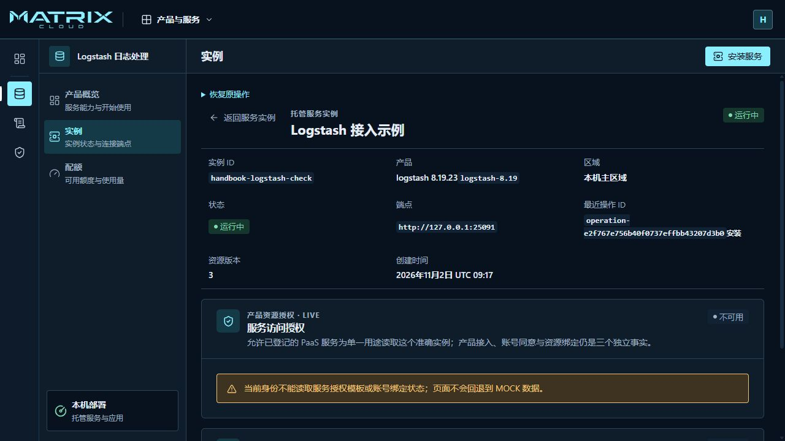

向管理员领取该实例的业务密码，并确认客户端能够到达详情中的连接地址。
本机示例地址以 `http://127.0.0.1:` 开头；远程电脑不能直接使用这台主机的回环地址。

在常用 HTTP 客户端中配置一次测试请求：

| 连接项 | 如何填写 |
| --- | --- |
| 地址 | 自己实例详情中的完整端点 |
| 方法 | `POST` |
| 认证 | Basic Auth，用户名 `matrix`，密码由管理员安全交付 |
| 请求内容 | JSON，例如 `{"message":"Matrix Logstash connection check"}` |

请求成功后，请管理员核对该条事件已保存，再交给应用使用。只有页面显示“运行中”，
还不能替代真实发送和落盘确认。Matrix 登录密码、访问密钥、凭据引用都不是这里的业务密码。
详情中的 **服务访问授权** 管理平台服务的受托权限，不是 Logstash 的业务连接凭据。

### 4. 日常使用、维护与释放

日常先核对实例 ID、连接地址和最近操作。维护后，用原地址和原业务密码再次发送
测试日志，并由管理员确认原事件仍在。失败时提供实例 ID、操作编号和时间，
按[故障处理](troubleshooting.md)联系管理员，不重建实例来碰运气。

当前交付配置固定为“认证接收 → 实例内保存”。自定义 Pipeline、转发目标及
日志检索需要另外明确支持范围；产品团队按[产品接入手册](../product-guide/managed-service-onboarding.md)
扩展并验收配置后才能交付。

停用前先导出需要保留的事件并停止日志发送，再按[终止实例](#不再使用一个实例)
审阅并提交。终止会删除该实例的数据与业务凭据；平台备份不能恢复这些业务事件。
等待详情显示 **已终止**，再到配额页确认可用数量归还。

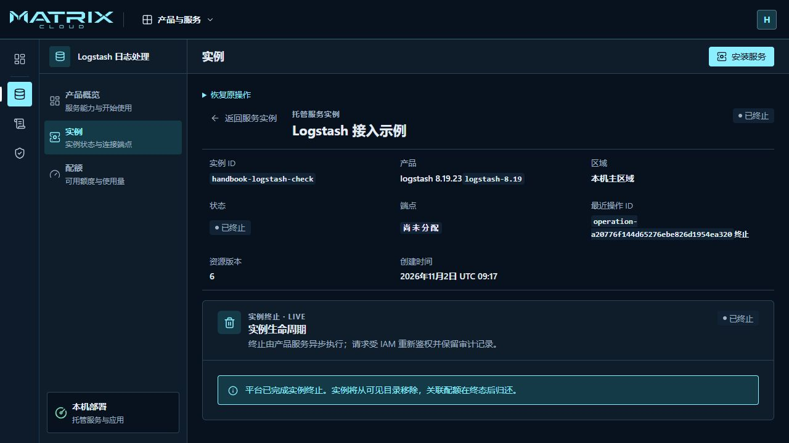
平台维护命令见[安装与维护指南](../runbooks/platform-installation.md)，适用版本与
验收证据见 [Logstash 接入记录](../features/FEAT-007-control-plane-console.md#logstash-平台集成候选)。

## 示例：为 Elasticsearch 开通 Kibana

本例用于已经包含 Kibana 的交付包。Kibana 连接同一账号中的 Elasticsearch，
提供浏览器中的数据查看入口。先确认这套环境的数据备份与凭据交付方式。

### 1. 准备可用的 Elasticsearch

1. 从 **产品与服务 → Elasticsearch** 开通服务、激活配额并创建实例。
2. 本例创建 `elk-search`，显示名称为 `ELK 搜索示例`，选择 **Elasticsearch 8.19 · 标准型** 和 **本机主区域**。
3. 等待实例显示 **运行中**，记下实例名称和 ID。
4. 请管理员确认你有这个实例的使用权限，以及创建 Kibana 所需的权限。

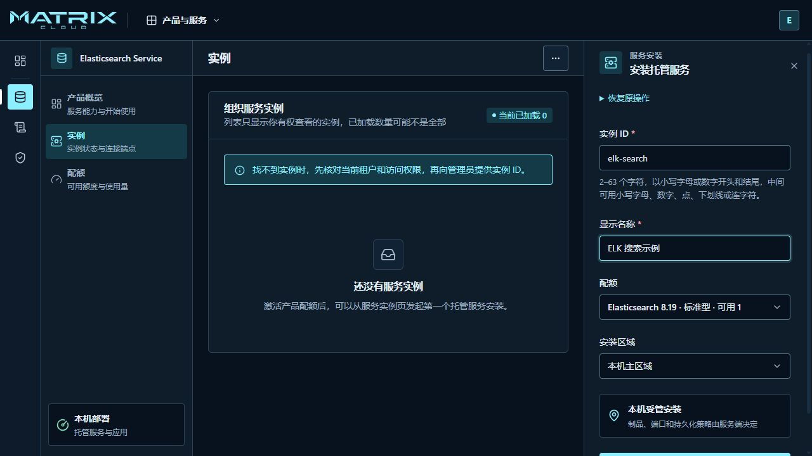

能看到 Elasticsearch，不代表有权把它关联给 Kibana。两个产品还须处于同一区域、
使用交付包支持的配套版本；无需自行填写地址、网络名或服务密码。

### 2. 创建 Kibana 并选择关联实例

1. 从 **产品与服务 → Kibana** 开通服务，在 **配额** 中准备一个开发型实例。
2. 进入 **实例 → 安装服务**，本例填写实例 ID `elk-views`、显示名称 `ELK 可视化示例`，选择 **Kibana 8.19 · 开发型** 和 **本机主区域**。
3. 在 **Elasticsearch 实例** 中选择刚才确认的实例，核对名称和 ID 后提交一次安装任务。
4. 打开原实例详情，等待状态成为 **运行中**，核对 **关联 Elasticsearch** 是否正确。

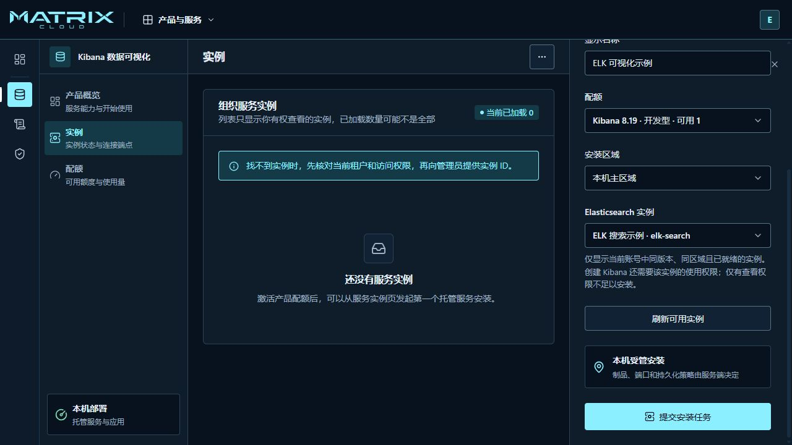

列表只显示当前账号内符合条件的实例。列表为空时，先检查 Elasticsearch 是否运行、
区域与版本是否匹配，以及自己的读取权限；不要反复创建 Kibana。
若页面提示所选实例已变化，使用 **刷新可用实例** 重新读取并选择。已经提交但结果未知时，
按[恢复原操作](troubleshooting.md#提交后断线或显示结果未知)处理，保留原请求中的选择。

### 3. 打开 Kibana 并验证数据

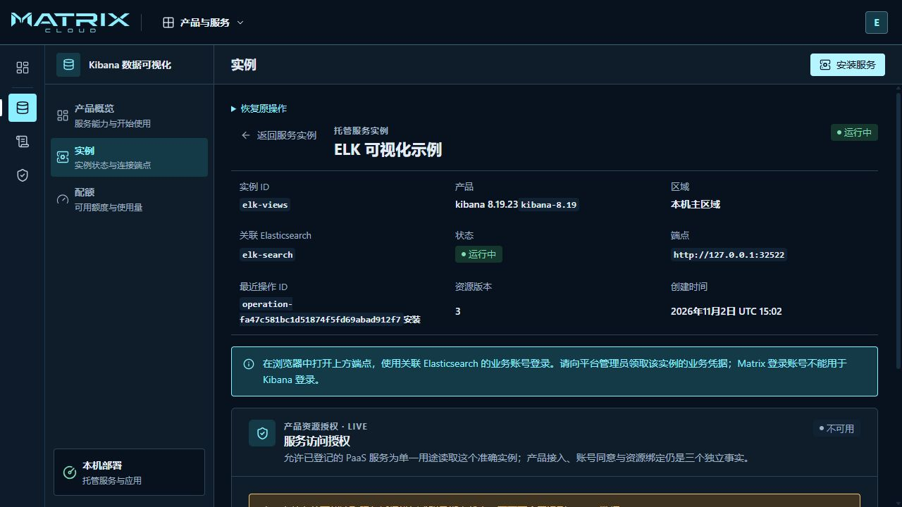

从详情取得自己的端点，由管理员确认浏览器到该端点的连接方式。
在 Kibana 登录页使用关联 Elasticsearch 的业务账号；Matrix 登录账号、
访问密钥和凭据引用都不能当作这里的业务密码。

本例先由管理员在 Elasticsearch 准备一个只有示例数据的 `matrix-handbook-elk` 索引，
含 `@timestamp` 时间字段和一条已知事件。使用自己的索引时，先向数据负责人确认名称与时间字段。

1. 首次登录出现欢迎页时，选择 **Explore on my own**，再进入 **Analytics**。
2. 选择 **Create data view**。名称填写 `Matrix ELK 示例`，**Index pattern** 填写 `matrix-handbook-elk`。
3. 确认右侧显示匹配到一个来源，**Timestamp field** 选择 `@timestamp`，点击 **Save data view to Kibana**。
4. 进入 **Discover**，确认左上角已选择这个数据视图，并在 **Documents** 中看到已知事件。

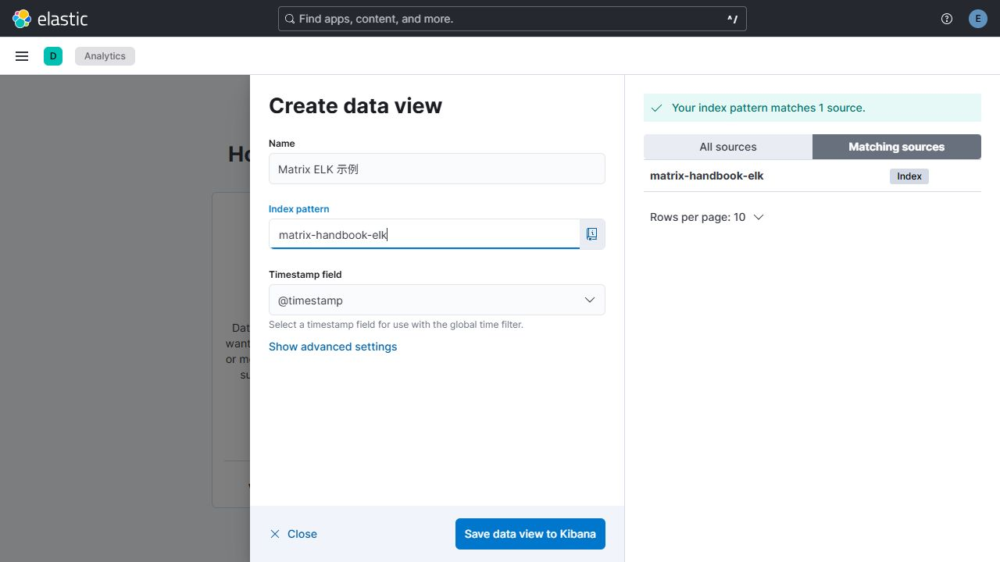

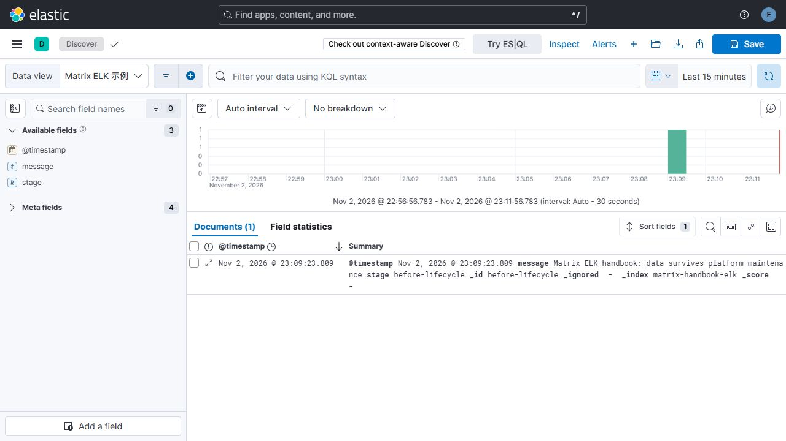

已有数据视图时直接打开它。若没有数据，先检查右上角时间范围是否覆盖测试事件；
不要仅因默认的 **Last 15 minutes** 没有结果就重新创建实例。仅打开登录页还不算数据接入成功。
同一 Elasticsearch 下的多个 Kibana 共享其中保存的数据视图；修改或删除这些内容前，
先与共同使用的团队确认影响。

### 4. 维护与停用

维护后用原连接方式重新登录，检查原数据视图和已知数据仍在。
打不开页面时先核对实例状态与网络；登录或数据访问失败时，请管理员检查关联
Elasticsearch 的状态与业务凭据。不要重建依赖来尝试修复。

维护跨越默认时间范围时，点右上角日期选择器，改为覆盖事件的范围，例如 **Last 1 hour**。

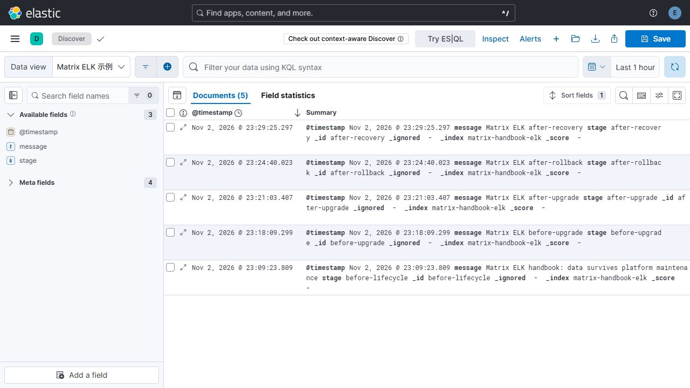

只停用 Kibana 时，按[终止实例](#不再使用一个实例)审阅并提交，等待 **已终止**。
它的独立入口与服务凭据会释放，关联 Elasticsearch 中的数据和保存的数据视图会保留。
还需删除 Elasticsearch 时，先备份业务数据，终止所有关联 Kibana 并等待清理完成。
页面提示仍有关联实例时，应核对原实例的清理状态，不绕过平台删除容器。

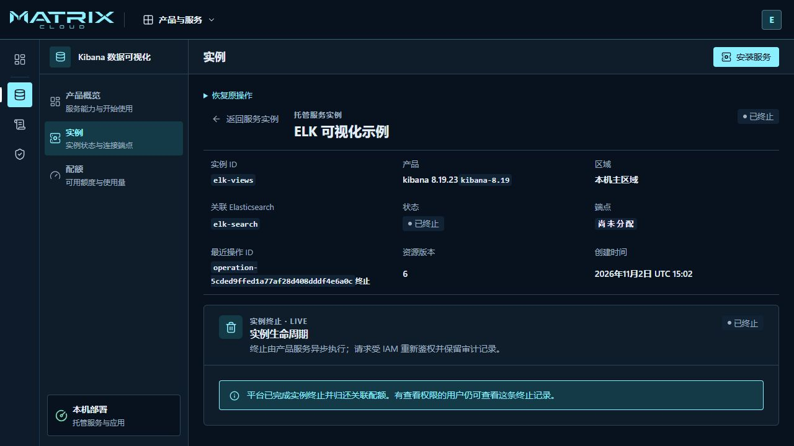

平台维护命令见[安装与维护指南](../runbooks/platform-installation.md)。
实际交付版本与验收边界见 [Kibana 接入记录](../features/FEAT-007-control-plane-console.md#kibana-依赖接入切片)。

## 示例：开通并验证 Redis

这个例子从一个新实例开始，用测试键确认真实连接。交付版本与支持范围见
[Redis 接入记录](../features/FEAT-007-control-plane-console.md#redis-接入切片)。

### 1. 开通服务并准备配额

打开 **产品与服务 → 数据库 → Redis**，选择 **开通服务**。
进入 **配额 → 激活配额**，选择开发型和所需实例数量，再确认激活。
开通和配额由同一账号共享；其他成员仍需要自己的 IAM 操作权限。

### 2. 创建并等待实例就绪

进入 **实例 → 安装服务**，填写实例 ID `handbook-redis-check`、显示名称
`Redis 缓存示例`，选择刚激活的 Redis 配额和 **本机主区域**，提交安装任务。

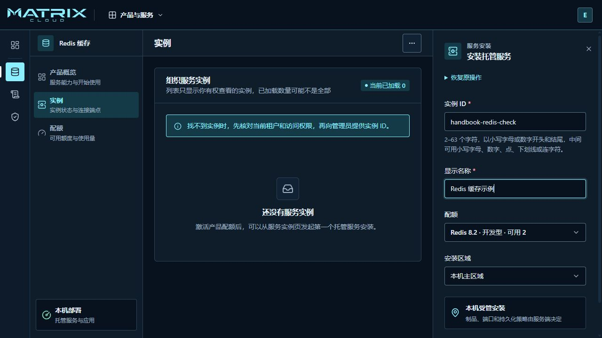

打开实例详情，等待状态从 **等待处理／安装中** 更新为 **运行中**。
页面会继续读取任务状态，不需要反复提交。连接端点出现后，再开始业务验证。
提交后断线或结果未知，按[恢复原操作](troubleshooting.md#提交后断线或显示结果未知)核对。

### 3. 用客户端写入并读回测试数据

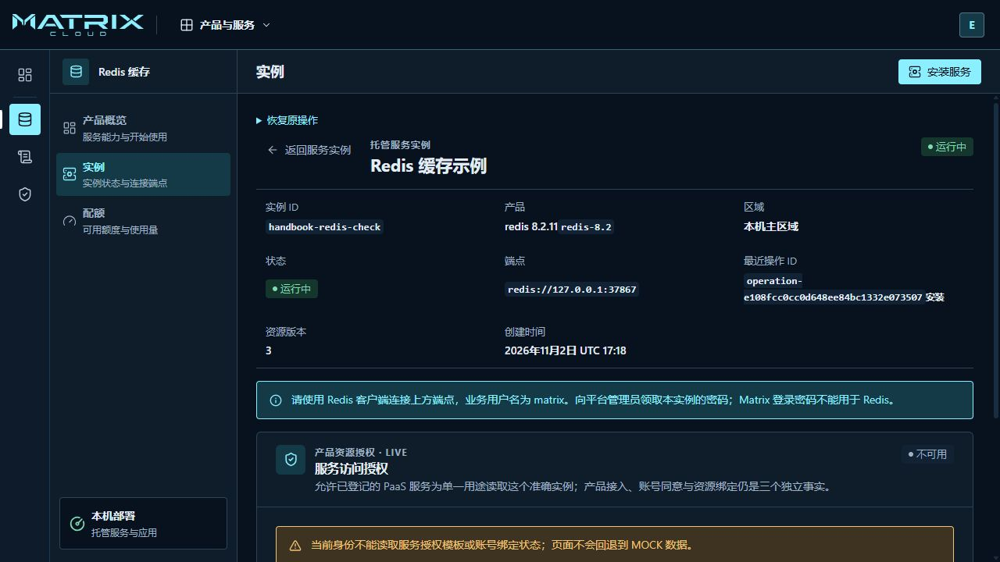

在 Redis 客户端中填写详情页的主机、端口，用户名使用 **matrix**，密码由管理员
通过受控渠道交付。Matrix 登录密码和访问密钥不能用于 Redis。
端点中的 `127.0.0.1` 指安装主机；远程连接方式由管理员提供，不能把它当作自己电脑上的服务。

连接这个新实例后，在客户端执行：

```text
SET matrix-handbook:check hello-matrix
GET matrix-handbook:check
```

第一条返回 `OK`，第二条返回 `hello-matrix`，才算完成实际读写验证。
保留这个测试键用于维护后复查；日常使用应根据业务需要设置过期时间。
认证、权限或容量错误的处理见[Redis 连接与写入问题](troubleshooting.md#redis-连接与写入问题)。

### 4. 维护后复查，再停用

平台维护后重新登录，确认实例运行，再用原连接方式读取测试键并尝试写入新值。
平台备份保护平台状态，不能代替 Redis 业务数据备份；需要恢复业务数据时，联系资源负责人。

确认应用已停止使用、必要数据已备份后，按[终止实例](#不再使用一个实例)审阅并提交，
等待 **已终止**，再核对端点释放与配额归还。删除一个实例前，应确认选中的实例 ID，
不能用重建实例替代故障恢复。

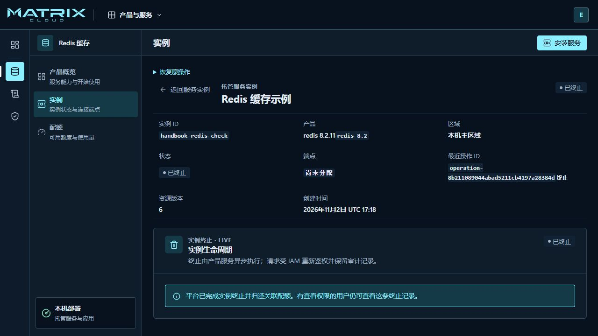

## 日常查看与移交

从实例详情核对名称、ID、状态、端点、操作编号和失败说明。
请求同事协助时，提供这些非秘密信息及发生时间，不发送密码或完整访问令牌。

实例详情中若提供服务角色授权入口，应逐项审阅受托用途与目标实例后再确认。
为服务授权不等于给普通成员授权，也不等于发放数据库连接密码。

## 不再使用一个实例

终止实例可能删除该实例的数据。操作前先确认应用已停止使用、必要数据已单独备份，
并与资源负责人确认影响范围。

1. 在实例详情中打开 **终止实例** 的审阅入口。
2. 核对目标名称、实例 ID 和页面列出的删除范围，再按要求确认。
3. 提交后等待原实例进入终态，并核对配额变化。
4. 收到不明确的结果时，先恢复原操作；不要从资源消失或请求超时推断删除成功。

如果按钮不可用，按页面说明处理权限、当前状态或未完成操作，
不要绕过平台直接删除 Docker 容器或存储目录。

## 查看应用与交付进度

具备读取权限且当前交付界面提供入口时，从 **应用托管** 打开应用列表，
选择具体应用查看详情。不同身份可见范围不同；列表为空不证明整个账号没有应用。

当前主线的真实控制台应用接口主要提供列表与详情读取。
**不要按照体验页面寻找一键创建应用、自动构建、发布、回滚或日志查询的完整流程。**

需要发布或回滚时，将应用名称、目标版本、配置要求和预期结果交给交付管理员。
由管理员使用已验收的应用接口执行，再返回应用与操作编号供你核对。
如果没有准备好的交付流程，应先完成平台交接，不能用 MOCK 操作代替上线。

## 当前不在这条使用流程内的能力

监控与日志产品页、源码到镜像再到自动部署的完整链路，不能从演示入口推断为已交付。
托管数据库的高可用、时间点恢复和引擎升级，也不能通过修改实例名称或重建实例来替代。

应用与服务的具体范围分别见
[应用执行](../features/FEAT-004-compose-application-execution.md)、
[控制台与托管服务](../features/FEAT-007-control-plane-console.md)及
[持续交付](../features/FEAT-012-paas-continuous-delivery.md)。
