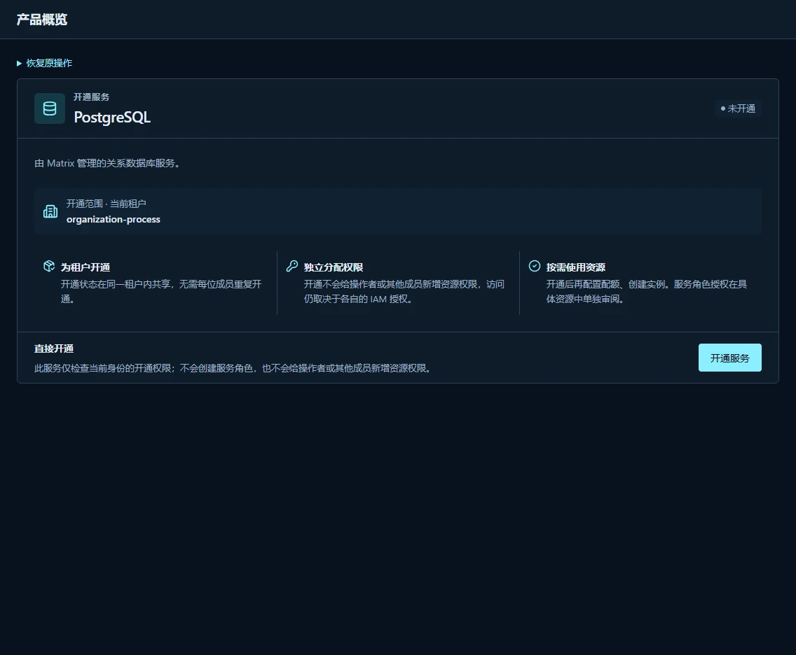
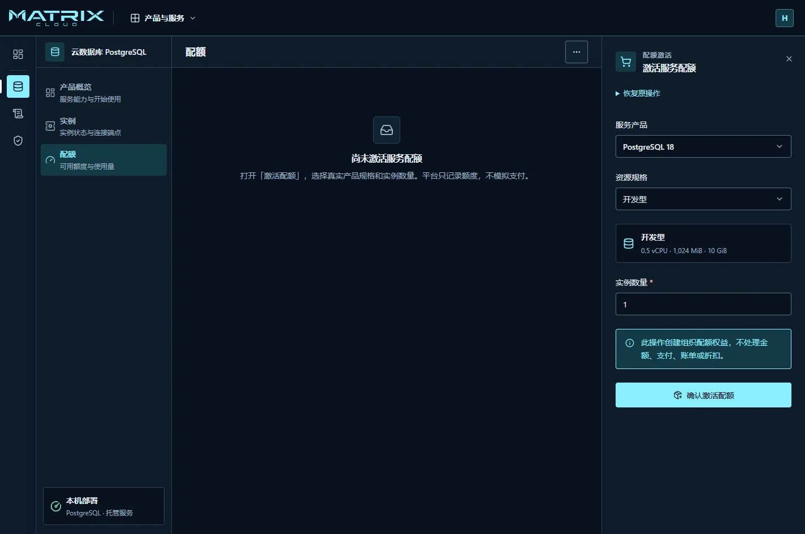
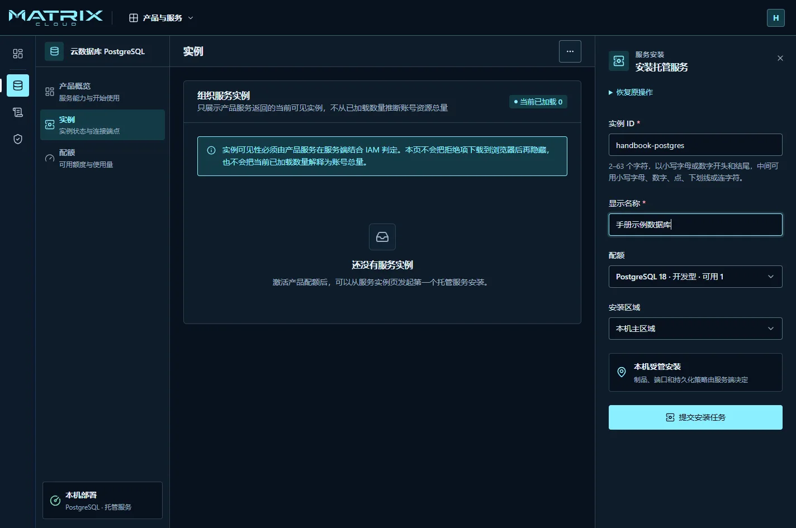
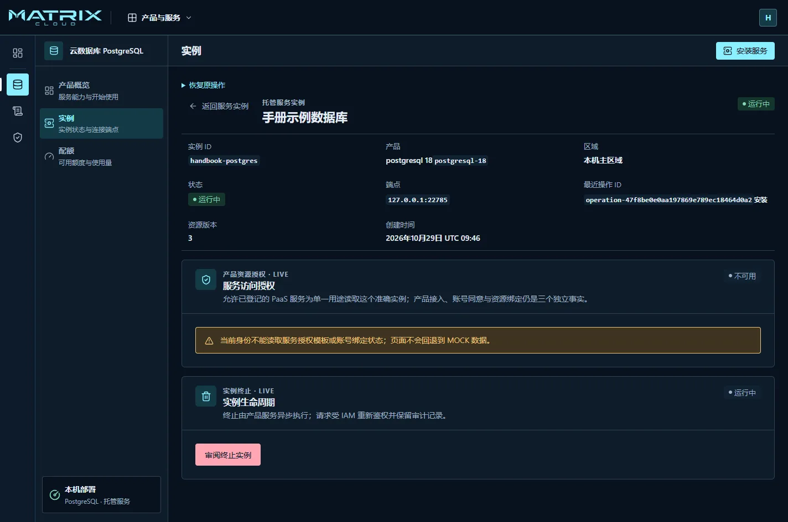
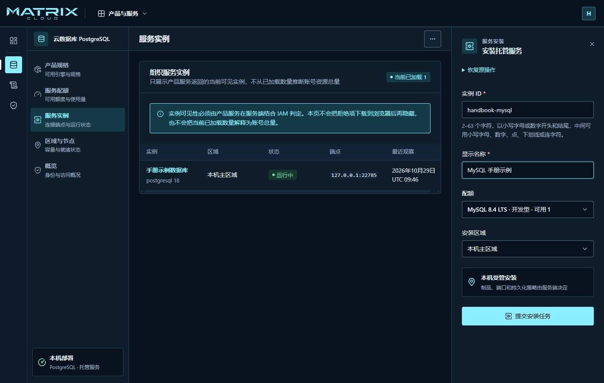
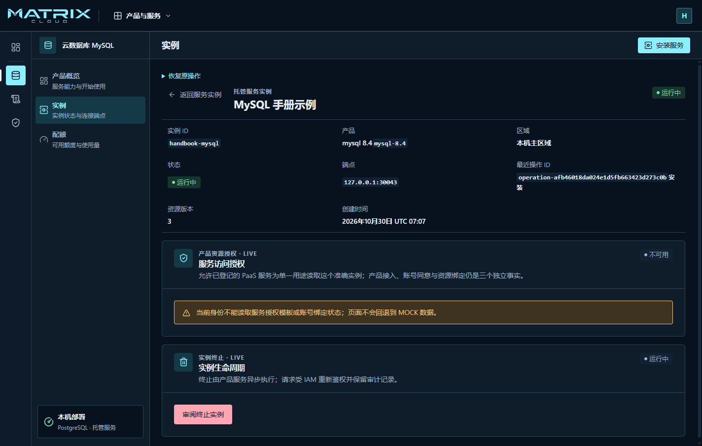

# 使用托管服务与查看应用

先检查当前登录的账号，确认你有目标服务的使用权限。
服务是否已经开通、你的操作权限、可用配额和实例运行状态，是四件不同的事。

## 申请第一个托管服务

下面以 PostgreSQL 为例；另有一条[MySQL 实例示例](#示例安装并连接-mysql)。
Elasticsearch 和 RabbitMQ 从各自服务入口开始，按平台实际提供的规格操作。
实例里要保存真实业务数据前，先与运维人员确定数据备份和恢复方案。

### 第一步：打开服务并确认开通状态

1. 从 **产品与服务** 找到目标服务；也可以从 **产品规格** 的“进入服务”进入。
2. 如果页面显示 **未开通**，由有开通权限的人员点击 **开通服务**。
3. 等待页面进入产品概览。此时服务在当前租户范围内开通，团队成员不必逐人重复开通。

开通服务不会自动创建实例，也不会给所有成员授予资源权限。
看得到服务但不能创建资源时，请管理员核对具体操作权限。

### 第二步：配置配额

1. 进入该服务的 **配额** 页面，点击 **激活配额**。
2. 选择服务产品、资源规格和需要的实例数量。
3. 核对后点击 **确认激活配额**。
4. 确认配额列表出现对应规格，并查看可用数量。

配额是当前账号可申请的额度，不是已经创建的实例。
这里不处理付款、账单或折扣；不要把激活成功当作支付成功。

### 第三步：提交实例安装

1. 进入 **实例** 页面，点击 **安装服务**。
2. 填写唯一的实例 ID 和容易识别的显示名称。
3. 选择仍有可用数量的配额，以及页面提供的安装区域。
4. 核对后点击一次 **提交安装任务**，等待平台回执。

实例 ID 请按输入框提示填写。资源规格、制品、端口和存储方式由平台提供，
当前流程没有上传任意镜像或填写任意部署模板的入口。

### 第四步：等待就绪

返回实例列表，打开目标实例，查看状态、操作编号与连接端点。
**提交被接受只表示任务已经进入处理，不代表服务已经可连接。**

- 处理中：留在原实例页面查看后续状态，不再创建同名实例。
- 运行中：再进入连接验证。
- 失败：保留实例 ID、操作编号和页面错误码，请运维人员检查；先确认原任务结果，再决定下一步。
- 结果未知或页面断线：使用页面的 **恢复原操作**，见[恢复未知结果](troubleshooting.md#提交后断线或显示结果未知)。

### 第五步：连接与验证

1. 从实例详情核对平台返回的端点及所属区域。
2. 请管理员确认你的应用所在网络能够到达该端点。`127.0.0.1` 指服务所在主机，
   不是你正在使用的任意一台电脑；远程访问前须由管理员安排连接方式。
3. 向负责该服务的管理员取得获准的业务连接方式与凭据交付方案。
4. 用测试数据完成一次连接验证，再接入业务。

控制台不会直接显示数据库明文密码，凭据引用也不是可以当作密码使用的内容。
目前没有通用的“查看密码／复制完整连接串”用户流程。
**只有端点、没有完成凭据与网络交付时，不应承诺应用已经可以使用数据库。**
Matrix 的登录密码、访问密钥和数据库业务密码也不能混用。

## 示例：安装并连接 MySQL

下面用一个小型测试实例走完“开通 → 配额 → 安装 → 连接”的流程。
示例名称可以替换，实例 ID 必须在自己的账号内唯一。

### 1. 开通 MySQL 并准备一个实例的配额

1. 打开顶部 **产品与服务 → MySQL**。页面仍在读取状态时，先等待加载完成。
2. 尚未开通时点击 **开通服务**；已经开通时直接继续。
3. 点击 **配置配额**，再点击 **激活配额**。
4. 服务产品选 **MySQL 8.4 LTS**，规格选 **开发型**，实例数量填 `1`，提交 **确认激活配额**。
5. 确认配额显示“已激活 1、可用 1”。开发型适合本示例；业务使用前应由管理员确认规格。

### 2. 安装示例实例

进入 MySQL 的 **实例** 页面，等权限检查完成后点击 **安装服务**。
也可以从控制台首页的通用 **服务实例** 页面打开同一安装表单；下图使用这个入口。

| 填写项 | 本例选择 |
| --- | --- |
| 实例 ID | `handbook-mysql` |
| 显示名称 | `MySQL 手册示例` |
| 配额 | **MySQL 8.4 LTS · 开发型** |
| 安装区域 | **本机主区域** |

核对配额确实属于 MySQL，再点击一次 **提交安装任务**。
返回实例列表，打开 **MySQL 手册示例**，等待状态成为 **运行中**。
不要将“平台已接受”当作已经安装成功。

### 3. 取得连接材料并验证

向管理员领取业务连接材料，在团队使用的数据库客户端中填写：

| 连接项 | 如何填写 |
| --- | --- |
| 数据库类型 | MySQL |
| 地址和端口 | 以你自己的实例详情为准；截图中的端口只是本例结果 |
| 数据库名 | 本交付组合的业务库为 `service`，由管理员确认 |
| 用户名和密码 | 使用管理员交付的业务账号；本例使用 `matrix_service` |

本机截图中的 `127.0.0.1` 不适用于任意远程电脑。先确认客户端到实例的网络路径，
再测试连接。密码由管理员安全交付，控制台的凭据引用不能当作密码使用。

连接成功后，在这个测试实例中新建一张测试表、写入一条测试数据，再查询确认内容一致。
三步都成功后，再把连接交给应用使用。仅看到绿色“运行中”还不能替代自己的连接验证。
实例详情下方的 **服务访问授权** 是平台服务的受托权限，不是数据库连接密码。

日常可以重新打开实例详情核对状态和端点。用完测试实例后，按
[终止实例](#不再使用一个实例)核对数据和影响，再决定是否释放资源。
本例的真实运行与验证范围见[界面复核记录](../features/FEAT-007-control-plane-console.md#用户手册界面复核)。

## 日常查看与移交

从实例详情核对名称、ID、状态、端点、操作编号和失败说明。
请求同事协助时，提供这些非秘密信息及发生时间，不发送密码或完整访问令牌。

实例详情中若提供服务角色授权入口，应逐项审阅受托用途与目标实例后再确认。
为服务授权不等于给普通成员授权，也不等于发放数据库连接密码。

## 不再使用一个实例

终止实例可能删除该实例的数据。操作前先确认应用已停止使用、必要数据已单独备份，
并与资源负责人确认影响范围。

1. 在实例详情中打开 **终止实例** 的审阅入口。
2. 核对目标名称、实例 ID 和页面列出的删除范围，再按要求确认。
3. 提交后等待原实例进入终态，并核对配额变化。
4. 收到不明确的结果时，先恢复原操作；不要从资源消失或请求超时推断删除成功。

如果按钮不可用，按页面说明处理权限、当前状态或未完成操作，
不要绕过平台直接删除 Docker 容器或存储目录。

## 查看应用与交付进度

具备读取权限且当前交付界面提供入口时，从 **应用托管** 打开应用列表，
选择具体应用查看详情。不同身份可见范围不同；列表为空不证明整个账号没有应用。

当前主线的真实控制台应用接口主要提供列表与详情读取。
**不要按照体验页面寻找一键创建应用、自动构建、发布、回滚或日志查询的完整流程。**

需要发布或回滚时，将应用名称、目标版本、配置要求和预期结果交给交付管理员。
由管理员使用已验收的应用接口执行，再返回应用与操作编号供你核对。
如果没有准备好的交付流程，应先完成平台交接，不能用 MOCK 操作代替上线。

## 当前不在这条使用流程内的能力

监控与日志产品页、源码到镜像再到自动部署的完整链路，不能从演示入口推断为已交付。
托管数据库的高可用、时间点恢复和引擎升级，也不能通过修改实例名称或重建实例来替代。

应用与服务的具体范围分别见
[应用执行](../features/FEAT-004-compose-application-execution.md)、
[控制台与托管服务](../features/FEAT-007-control-plane-console.md)及
[持续交付](../features/FEAT-012-paas-continuous-delivery.md)。
