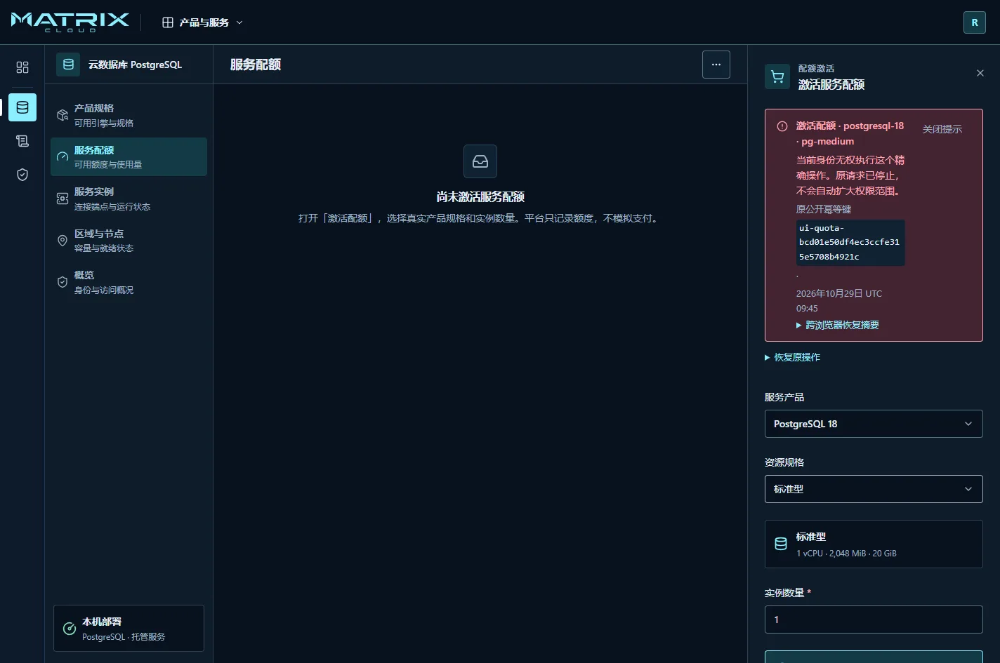

# 遇到问题与故障恢复

先记录发生时间、当前账号、目标资源和页面提示。涉及创建、删除、改密等操作时，
**超时不等于失败，刷新不等于取消**；先确认原操作的结果。

## 无法打开控制台

1. 使用管理员交付的完整地址，确认网络接入方式正确。
2. 不要自行修改 HTTP／HTTPS、域名或端口。
3. 请管理员执行[状态与健康检查](../runbooks/platform-installation.md#日常检查)。
4. 地址、网络和平台状态确认后仍打不开时，提交发生时间和浏览器错误提示。

当前安装入口的限制见[安装前准备](../runbooks/platform-installation.md#安装前准备)。
如果是刚装的新环境，先让管理员确认安装命令已经成功，且平台状态为就绪。
版本与实测范围见[本地安装结果](../features/FEAT-005-offline-platform-lifecycle.md#当前主线本机-docker-安装复核)。
平台尚未启动时，重置登录密码不能解决连接问题。

## 登录失败或刚输入就返回登录页

- 核对 **主账号／IAM 子账号** 是否选对；子账号需要完整的 `用户名@账号`。
- 使用管理员发给你的登录名，不使用显示名称或邮箱替代。
- 密码输入错误、账号停用或尝试过于频繁时，按页面提示处理，不连续试猜。
- 新账号在“设置你的正式密码”页开始输入就退出，不属于正常改密流程。
  该问题已有修复；请交付管理员核对[已验证版本](../features/iam/FEAT-IAM-010-console.md#首次改密修复与验证)，
  不要通过取消强制改密或修改数据库绕过。

普通页面刷新、登录到期或权限被撤销，也可能要求重新登录。
这与账号被删除不是同一件事。首次改密成功则会直接进入控制台，无需再次登录。

## 没有权限或找不到按钮

1. 在 IAM 概览确认当前账号和当前身份，特别注意是否正在使用角色身份。
2. 记录要访问的产品、具体资源和操作，以及页面提供的请求编号。
3. 请管理员检查直接策略、用户组来源、权限边界和资源状态。
4. 权限调整后使用页面提供的 **重新检查权限**，必要时重新登录再试。

登录成功不等于拥有所有权限。服务已开通、配额充足，也不能代替操作权限。
当前没有可对所有拒绝自动生效的“申请权限”审批流程，应通过团队已有渠道联系管理员。

图中的拒绝是权限生效后的正常结果。保留原提示，向管理员说明工作需要，不反复提交。

## 页面没有数据或提示无法读取

区分页面正在说什么：

| 页面提示 | 你应当做什么 |
| --- | --- |
| 没有资源／尚未创建 | 核对账号和筛选条件，再按权限创建或联系管理员 |
| 无权读取 | 申请所需读取权限，不猜测其他账号的资源 ID |
| 服务暂不可用／读取失败 | 使用本区域的重试入口；持续失败时联系运维 |
| 返回内容不符合契约 | 保留错误提示，让运维检查前后端版本是否配套；不要清库或改权限来“修复” |
| 未提供／预览 | 确认交付范围，不将演示数据视为真实结果 |

读取失败时，不能据空白页面认定“没有操作记录”，也不能认定数据已经丢失。
当前交付界面的实测范围由[控制台功能记录](../features/FEAT-007-control-plane-console.md#用户手册界面复核)维护。

## 提交后断线或显示结果未知

1. 保留原页面提示与操作编号，先不要再次创建、删除或重置。
2. 优先使用当前页面的 **恢复原操作** 或完成结果查询入口。
3. 如果页面允许导出 **跨浏览器恢复摘要**，按提示保存这份非秘密摘要；
   在获准的新会话中导入并核查同一个操作。
4. 只有页面明确要求时，才重试原操作；不要用新表单或新编号替代。
5. 找不到恢复入口或身份不匹配时，将原摘要和资源编号交给管理员处理。

不同操作的恢复方式不同：有的只查询原结果，有的允许显式重试同一个请求。
恢复摘要不包含权限，也不能当作密码或令牌；不要把凭据塞进摘要。

## 实例一直处理中或连接失败

先查看实例状态、操作编号与失败码。
服务还未就绪时，不用反复测试数据库密码；已经就绪但连接失败时，
请服务管理员分别确认端点、网络可达性和业务凭据。

平台登录成功不证明数据库网络畅通。创建了新实例也不会自动把旧实例的数据搬过去。
运维人员需要检查承载区域、可用资源与执行服务，不应由普通用户直接删除宿主机容器。

## 密码或认证器不可用

- **普通成员忘记密码**：联系有权限的账号管理员重置，再按首次登录流程设置自己的密码。
  管理员按[重置成员密码](access-management.md#帮成员重置忘记的密码)操作，不需要更改成员的资源权限。
- **认证器不可用、仍有恢复码**：使用登录页或 **用户设置 → 本人安全** 中实际提供的恢复入口，按提示完成重新绑定。
- **所有验证方式都丢失**：联系平台交付人员核对受支持的恢复路径。
  特别是主账号或受保护平台身份，不承诺客服可以绕过验证恢复。
- **怀疑凭据泄露**：及时联系管理员停用受影响凭据，并检查登录会话和独立访问密钥。
  仅退出浏览器不能代替密钥处置。

## 平台升级失败或需要恢复备份

这部分由平台运维人员执行。普通用户只需停止重复提交变更，保存当前操作信息并等待通知。

运维人员按[平台升级与恢复](../runbooks/platform-installation.md#升级回滚与恢复)处理：
先检查状态和原操作，再区分继续原升级、版本回滚与备份恢复。
备份恢复会改变平台数据与登录状态，必须先确认影响；它不是普通的页面“重试”。

恢复后重新登录，重新读取资源和授权状态。旧会话或旧访问密钥不能因为恢复了旧备份就被视为重新有效。
托管服务业务数据需要自己的恢复方案，平台备份不能替代数据库数据备份。

## 向管理员提供什么

提供：发生时间及所在时区、账号 ID、资源 ID、操作或请求编号、错误码、
最后一次操作、预期结果，以及不含秘密的截图。

运维人员可以按[支持信息导出](../runbooks/platform-installation.md#导出支持信息)提供平台诊断材料。
首次安装没有成功时，支持导出也可能不可用；先提供安装错误和时间即可，不需要打包整个安装目录。
不要发送密码、AccessKey Secret、完整令牌、认证器二维码、恢复码、安全邮件配置或整份平台备份。

本手册不提供通用客服邮箱。使用部署团队交付的支持渠道；安全事件不要公开粘贴到仓库讨论区。
